## Roadmap {.smaller}

Three lectures. The first is the **idea**, the second is the **machine**, the
third is the **card** and the **model**.

**Lecture 1 — why a throughput machine at all**

1. **Latency vs throughput** — the bet, and the one equation that prices it
2. **SIMT** — how 64 lanes share a single program counter
3. *(with detours into the machines that tried this first)*

**Lecture 2 — how a GPU is built**

3. **Memory, inverted** — the hierarchy with the register file on top
4. **The machine** — from one compute unit to a whole card

**Lecture 3 — how a GPU is attached and programmed**

5. **PCI and PCIe** — why a GPU is a card and not a die
6. **Programming** — what the rewrite actually costs
7. Synthesis

::: {.notes}
Say the split out loud on the first slide; students plan around it.

Lecture 1 is the argument and stands alone. Lecture 2 is the architecture.
Lecture 3 is the systems lecture, and it is the one that will feel most like the
multicore material.

The archaeology slides are marked in amber and are *not* examinable. Say that
explicitly on the first one — it buys goodwill from the half of the room that
wants the story, and the half that wants the exam will forgive it.
:::

# Part 0 — Framing

## Where We Left Off {.smaller}

Last week: Moore's Law held, then **clocks stopped**.

| | 1971 | 2004 | 2022 |
|---|---|---|---|
| Transistors | 2.2 K | 125 M | 20 B |
| Clock | 740 kHz | 3 GHz | 3 GHz |

Clock speed has been pinned near 3 GHz since about 2005, because doubling
frequency quadruples power and a laptop CPU has a 10 W budget.

So there were three ways to spend the transistors, and we walked all three:

1. **Spend it on single-thread speed** — caches, deeper speculation, wide dividers.
2. **Copy and paste the core** — multicore, then multi-socket, then NUMA.
3. **Add specialised instructions** — vector units, crypto, video decode.

::: {.fragment}
There is a fourth, and it is the subject of the next three lectures:

> Stop trying to make one instruction stream finish sooner. Build a machine that
> runs thousands of them at once, and issues from whichever can make progress.
:::

::: {.notes}
This is a recap, not new material — keep it to two minutes. The point is that the
fourth path was available the whole time and nobody took it for consumer CPUs,
because it does not help the software people already had.

The multicore notes (`10-26-multiprocessors.md`) literally ended with the line "Let's figure
out how GPUs work." This is that.
:::

## Two Ways to Spend a Transistor {.smaller}

A CPU core and a GPU compute unit are made of the same stuff and spend it
oppositely.

| | **CPU core** | **GPU compute unit** |
|---|---|---|
| Area goes to | **not stalling** | **having something else to run** |
| Mechanisms | OoO window, branch predictor, L1/L2, prefetch | 64 lanes, 256 KB register file, LDS, 4 schedulers |
| Latency hidden by | prediction | concurrency |
| Breaks when | working set outgrows the cache | work diverges, or accesses are uncoalesced |
| Programmer sees | one instruction stream | 64 threads per instruction |

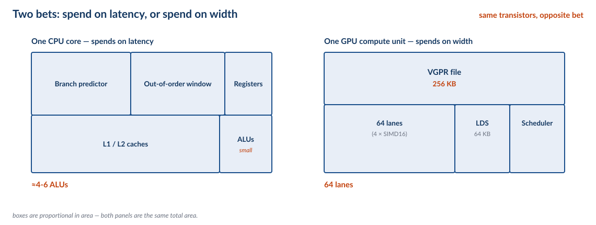{height=300px}

::: {.fragment}
Same transistors. Opposite bet. Almost every difference in this deck follows
from that one sentence.
:::

::: {.notes}
Put the two columns on the board and leave them there for the whole lecture.
Every mechanism we meet later hangs off one of these cells.

The row that matters most is "breaks when". A CPU degrades gracefully — a cache
miss costs you cycles. A GPU degrades catastrophically — a divergent branch or a
strided access can cost you 16×. That asymmetry is why GPU programming is hard,
and we come back to it in Lecture 3.
:::

## Every Boundary Is a Fabric {.smaller}

A machine is not one thing. It is a set of pools of storage and compute, and
**every boundary between two pools has a width.**

| Boundary | Width | Where |
|---|---|---|
| Register file → lanes | 64 × 4 B per cycle | every CU |
| Shared memory → lanes | ~128 B per cycle | every CU |
| L2 → CU | ~5 TB/s aggregate | MI50 |
| HBM2 → L2 | 1,024 GB/s | MI50 |
| Memory controller → CPU | **~140 GB/s** <span class="measured">measured</span> | vampire |
| Host → GPU | 15.75 GB/s | PCIe 3.0 x16 |
| Host → anything | 0.06 GB/s | USB 2.0, sg2000 |

::: {.fragment}
Read the column down: **five and a half orders of magnitude**. Every part of this deck is
one of these boundaries, and every performance number we quote is set by the
narrowest one a program is forced to cross.
:::

::: {.notes}
This is the spine of all three lectures. Write it on the board at the start and point
at it every time a new number appears.

The last two rows are the interesting ones. The CPU's own path to memory is not
the widest thing in the machine — it is *narrower than the memory controller
behind it*, which we will measure in Part III. And the sg2000 has no row above
USB 2.0 at all, which is why it has no GPU.

Green = we measured it on our own hardware. Grey = spec sheet. Keep that
distinction honest all the way through.
:::

## What We Will Not Do Today {.smaller}

- **No graphics.** No shaders, no rasterisation, no texture mapping. A GPU is a
  computer that happens to be good at triangles.
- **No CUDA or HIP tutorial.** The programming model is Lecture 3's last part.
- **No cache mechanics.** We assume the memory-hierarchy deck.
- **The TPU gets one slide.** It has its own lab.

::: {.fragment}
Two questions we *will* answer:

1. **How do you build a machine with 3,840 arithmetic lanes?** (Lecture 1)
2. **How do you feed it?** (Lecture 3)
:::

::: {.notes}
Scope-setting matters more than usual here because GPUs invite digression. The
graphics pipeline is the biggest trap — students expect it, and it teaches almost
nothing about architecture.

If someone asks why we skip graphics: because the interesting part of a GPU is
that it is a general-purpose throughput machine, and you can demonstrate that
without drawing a single triangle.
:::

# Part I — Latency vs Throughput

## The CPU's Bet {.smaller}

Everything in the pipelining deck was spent on one goal: make **one**
instruction stream finish sooner.

| Mechanism | Buys | Costs |
|---|---|---|
| Branch predictor | no fetch bubble on a taken branch | area, energy, a flush on a miss |
| Out-of-order window | independent work found in one stream | ROB, rename, wakeup logic, power |
| L1 / L2 caches | most loads never reach DRAM | area, plus latency on the way through |
| Speculation | hides control latency | everything must be undoable |

::: {.fragment}
Look at the cost column. Every entry is **area and energy spent to avoid
waiting** — and none of it helps if the program genuinely has nothing else to do.
:::

::: {.notes}
This is deliberately a recap of the pipelining deck. Students should recognise
every row.

The last clause is the set-up for the GPU: a CPU's tricks all assume there is
latency to *hide*, not work to *find*. A GPU assumes the opposite — there is
always more work, and the problem is that one thread cannot get to it.
:::

## The GPU's Bet {.smaller}

Now delete the cost column and spend the same area differently.

| Mechanism | Buys | Costs |
|---|---|---|
| No out-of-order | the scheduler *is* the out-of-order | one wavefront runs in lockstep |
| Minimal prediction | fewer branches to predict | divergence must be masked (Part II) |
| Tiny caches | area freed for lanes | every miss goes to DRAM |
| **256 KB register file per CU** | 40 resident wavefronts | no room for big caches |

::: {.fragment}
One MI50: 60 CUs × 256 KB = **15.0 MiB of register file** — nearly four times its
own 4 MB L2. The hierarchy has been turned inside out.
:::

::: {.notes}
The register-file number is the one to land. On a CPU, registers are a rounding
error next to the caches. On a GPU they are the biggest structure in the core,
because registers are where you keep the state of the threads you are *not*
currently running.

Say it plainly: a GPU is not a fast processor. It is a machine for holding an
enormous number of half-finished threads, and the throughput comes from having so
many that the scheduler always finds a ready one — not because it switches to
them, but because they were never switched out.
:::

## Four Attempts at a Throughput Machine {.smaller}

The GPU is not the first machine to make this bet. It is the first one to win it.

| | SIMD width | Independent streams | Outcome |
|---|---|---|---|
| **Itanium** (2001) | 3-wide VLIW | 1 per core | lost — no parallelism to fill the width |
| **SPARC T2** (2007) | 1 (scalar) | 8 per core, 2 issue slots | lost — too narrow to matter |
| **Knights Landing** (2016) | 32 (2 × AVX-512) | **4** per core | lost — a compromise on every axis |
| **GPU** (2006–) | 16–32 | 10 per scheduler | **won** |

::: {.fragment}
Itanium had width and no threads. T2 had threads and no width. KNL had both —
*plus* out-of-order execution and x86 compatibility — and still lost.
:::

::: {.fragment}
So it is not "more mechanisms wins". KNL hedged on every axis and was best at
none. The GPU **dropped** out-of-order and dropped compatibility, and spent
everything on width and depth.
:::

::: {.notes}
This is the archaeology payoff slide, and it is examinable even though the
machines are not: the *axes* are the point.

**Itanium** (2001) was EPIC: 128-bit bundles of three instructions, no
out-of-order, no hardware speculation, and the compiler statically schedules
everything. It failed because the compiler cannot schedule around a cache miss it
cannot predict. It starved on lack of parallelism.

**SPARC T2** (2007) is the opposite: 8 cores × 8 threads, in-order, one scalar
lane each. It had threads and no width, and it kept coherent SMP memory and a
general-purpose ISA, so it lost to Xeons at single-thread while not being wide
enough to win at throughput. (Careful: T2 is *not* single-issue. Its eight
threads split into two groups of four, each with its own selector and integer
ALU, so it issues up to two instructions per cycle. Single-issue is the T1.)

**Knights Landing** (2016) is the interesting failure, and the one most often
misdescribed. It was not in-order — that was Knights Corner. KNL had 72
Silvermont-derived cores with **4-way SMT** and a **2-wide out-of-order** pipeline
(72-entry ROB), plus two AVX-512 units per core, so 32 lanes wide. Three
latency-hiding mechanisms: width, threads, *and* dynamic scheduling.

And it still lost, which is the real lesson. Four threads is not ten, a 2-wide
Atom-derived core has poor single-thread performance, and it demanded AVX-512-aware
code without giving GPU-like throughput in return. It was a hedge, and a hedge is
a machine that is best at nothing.

The GPU made the opposite trade: **no out-of-order at all**, no compatibility,
and everything into 10–16 streams of 16–32 lanes. Commitment beat compromise.

If a student asks "so which axis matters more" — the honest answer is that the
GPU is the only one of the four that gave anything *up*.
:::

## The Arithmetic of Hiding {.smaller}

DRAM on a GPU takes roughly **500 cycles**. A thread has about **4 cycles** of
independent work before it needs the load.

| Work per thread | Threads needed to cover 500 cycles |
|---|---|
| 4 cycles | **125** |
| 8 cycles | 63 |
| 16 cycles | 32 |
| 32 cycles | 16 |

::: {.fragment}
A CPU answers this with a bigger out-of-order window — it looks for the 125
cycles of work *inside* one thread. A GPU answers it by having 125 threads.
Same arithmetic, different lever.
:::

::: {.notes}
Do the division on the board: 500 / 4 = 125. It is not a hard calculation and
that is the point — the GPU's central design decision is arithmetic, not
mystique.

The honesty note: 500 cycles is an estimate, not a measurement. The exact number
varies with the memory clock and the access pattern. What matters is the order of
magnitude, and that it is far larger than the work available per thread.
:::

## Little's Law {.smaller}

::: {.eq}
concurrency = latency × throughput
:::

Equivalently, the number of threads you must keep resident to cover a stall:

::: {.eq}
threads = latency ÷ work-per-thread
:::

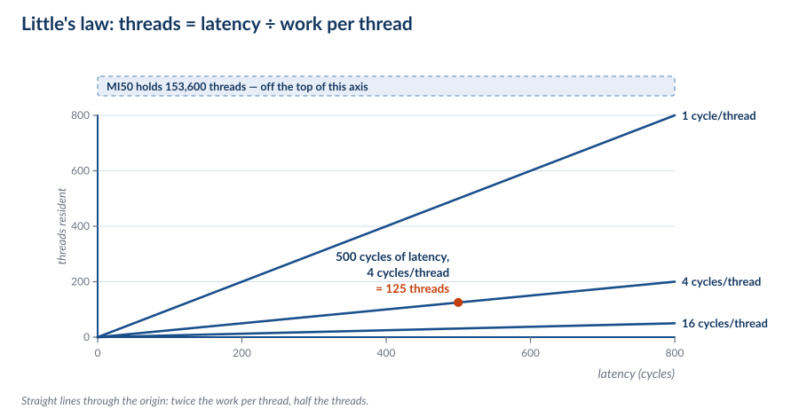{height=280px}

::: {.fragment}
This is the deck's one equation, the way AMAT was the memory deck's. It is also
the equation that sizes an outstanding-miss buffer, a DMA descriptor ring, and a
PCIe pipeline — you will meet it again in Part V.
:::

::: {.notes}
Write it on the board and keep it there.

The reason to give it a name is that it generalises: any time a system must
sustain a rate across a latency, it needs a buffer of that size. The GPU's
register file, the CPU's miss-status holding registers, and a DMA ring are the
same idea at three scales. That is a genuinely useful thing for students to
carry out of the course.

A MI50 at full occupancy holds 60 CUs × 40 wavefronts × 64 lanes = **153,600
threads**. That is Little's Law answered in silicon.
:::

## Archaeology: Tera MTA {.smaller .arch}

Tera Computer Company, 1998. The purest thread-depth machine ever built.

| | Tera MTA |
|---|---|
| Thread contexts per processor | **128**, each with its own register set |
| Thread switch | **every cycle**; blocked threads are skipped |
| Data caches | **none in the processor** |
| Memory | "full/empty" bits on every word — sync in hardware |
| First system | 4 processors, **512 threads**, gallium arsenide, at SDSC |

::: {.fragment}
Little's Law, taken to its conclusion and built. A GPU would recognise this
machine immediately: it is the same argument, twenty years early, in a CPU.
:::

::: {.notes}
**Archaeology slide — not examinable.** Flag that out loud the first time.

This is the best single artefact for the argument in this lecture. Tera looked at
memory latency, decided caching was a losing game, and gave every processor 128
register sets so there was always a runnable thread. The hardware switches thread
**every cycle** and simply skips the blocked ones. No data cache in the
processor at all — though be precise if pushed: the memory modules do carry a
tiny hot-spot cache for contended synchronisation words, about 256 words across
the whole machine.

That is worth pausing on, because it is the answer to a question from earlier in
the lecture: switching costs nothing *because all 128 register sets are already
resident*. There is no save and no restore. The same architectural fact as a
GPU's 256 KB register file.

The full/empty bits are a lovely extra: every memory word carries a state bit, so
synchronisation is a memory operation rather than a lock. A thread reading an
"empty" word simply blocks until someone writes it.

Two details worth having ready. The first MTA used **gallium arsenide** — a
material nobody builds CPUs from — and shipped four processors to the San Diego
Supercomputer Center, 512 threads in total. And the history is the opposite of
the usual telling: Tera did not die and get bought by Cray; in 2000 Tera bought
the Cray Research division from SGI and renamed *itself* Cray Inc.

The line to leave them with: **every machine that hides latency with threads
eventually looks like a GPU.** Tera got there first and had no graphics workload
to carry it.
:::

## One CU Is Not One Core {.smaller}

| | **CPU core** (Zen 5) | **GPU CU** (Vega 20) |
|---|---|---|
| Arithmetic width | 4–6 ALUs | **64 lanes** |
| Registers | ~1–2 KB architectural | **256 KB** |
| Scheduler | 1 out-of-order | 4 in-order |
| Local storage | 32–64 KB L1, then L2 | 16 KB L1 + **64 KB software-managed** |
| Resident threads | 2 | **2,560** (40 wavefronts × 64) |

::: {.fragment}
A CU is not a fat core. It is **16 cores' worth of lanes** with a completely
different latency strategy bolted on.
:::

::: {.notes}
The "2 resident threads" for a CPU is the SMT width. That contrast — 2 versus
2,560 — is the whole deck in one row.

Careful with the word "core". Vendors use it loosely: AMD calls a CU a CU, NVIDIA
calls it an SM, and both are closer to "a cluster of 16 cores that share a
scheduler" than to a CPU core. Say "compute unit" and mean the Vega 20 thing.
:::

## Archaeology: The Connection Machine {.smaller .arch}

Thinking Machines CM-2, 1987. The width axis taken to its conclusion.

| | CM-2 |
|---|---|
| Processors | **65,536**, one bit each |
| Interconnect | hypercube |
| Branches | **none** — no per-processor control flow at all |
| Communication | "news" — routing between processors |
| Floating point | optional Weitek FPU, **one per 32 processors** |

::: {.fragment}
A one-bit ALU is the most complete possible statement of "spend everything on
width". And it is also why the machine could not survive: real data is not
uniformly shaped.
:::

::: {.notes}
**Archaeology slide — not examinable.**

The CM-2 is the purest SIMD machine ever sold: 65,536 single-bit processors, one
instruction driving all of them, and *no branches whatsoever*. Where a GPU has an
exec mask, the CM-2 had nothing — you could not branch per processor, so the
programmer had to express everything as uniform data movement. The "news" network
was how processors exchanged values.

That is the same trade as Part II's divergence slide, taken to its limit: with no
per-lane control flow you never pay a divergence penalty, and you also cannot
write anything irregular.

The ending is the instructive part. Thinking Machines' next machine, the CM-5
(1991), abandoned SIMD for MIMD with a fat-tree network — the company pivoting
away from its own thesis — and the company was gone by 1994. The SIMD idea did
not die with it; it went into graphics hardware, where the data was uniform.
:::

## What We Bought {.smaller}

One MI50, from its own numbers:

| | |
|---|---|
| Lanes | 60 CUs × 64 = **3,840** |
| Clock | 1.725 GHz |
| FMA throughput | 3,840 × 2 flops × 1.725 GHz = **13.3 TFLOPS** FP32 |

Against celedyr — the 24-core Opteron box from the multicore lecture:

| | |
|---|---|
| Cores | 24, in **12 modules** |
| FPU | one **256-bit FPU per module**, shared by both cores |
| Per core | one 128-bit half = 8 flops/cycle |
| Throughput | 12 × 16 × 2.4 GHz = **≈ 0.46 TFLOPS** <span class="quoted">derived</span> |

::: {.fragment}
Twenty-four cores, but **twelve FPUs**. That 0.46 TFLOPS needs *both* cores in
every module doing dense FP work — put one thread on a module and you get half.
:::

::: {.fragment}
**29×** in one card, against a two-socket server. And that is the *easy*
comparison — it assumes the work is already perfectly parallel and dense.
:::

::: {.notes}
The 29× is deliberately the optimistic case, and the next slide is the bill.

The module structure is the thing to get right, because it is the same lesson as
"a CU is not a core" arriving from the other direction. A Bulldozer module is two
integer cores sharing **one** 256-bit FlexFPU built from two 128-bit FMACs. Each
core gets one half, so 8 flops/cycle per core — and there are twelve FPUs for
twenty-four cores, not twenty-four.

The arithmetic is unchanged: 12 modules × 16 flops/cycle = 192 flops/cycle, same
as 24 cores × 8. But the *peak requires two FP threads per module*. One thread
alone reaches half of it, which is why this part was so bad at exactly the dense
FP work the GPUs were about to eat.

Careful with codenames: SledgeHammer is K8, where every core had its own FPU. The
shared-FPU machine is Bulldozer/Interlagos, which is what is on celedyr.

Note the honesty marker on the Opteron number: it is a paper calculation from
module count, clock, and vector width, not a benchmark. If you want the real
number, run it — that is a good lab exercise.
:::

## What We Paid {.smaller}

- **Single-thread performance is bad.** No speculation, no out-of-order, narrow
  scalar path. A GPU is the slowest possible machine for one thread.
- **Every access must be shaped.** A warp that touches 64 scattered addresses
  costs 64 transactions.
- **The programmer must expose the parallelism.** The hardware will not find it.
- **Divergence is expensive.** Two paths through an `if` cost the sum, not the
  max.

::: {.fragment}
> The CPU hides latency from the programmer. The GPU makes the programmer
> responsible for it. That trade is the entire programming model, and it is why
> Lecture 3 exists.
:::

::: {.notes}
End Part I here and take questions. The four bullets are the syllabus for
Lecture 3, so flag them as such — students who stay for the third lecture will
see each one turned into a mechanism.
:::

# Part II — SIMT

## The Program {.smaller}

One million floats. Add two vectors:

```c
for (int i = 0; i < n; i++)
    c[i] = a[i] + b[i];
```

On a CPU this is a loop: one add at a time, maybe four if the compiler
vectorises it, and the loop overhead is real.

::: {.fragment}
On an MI50 we would like this to run on **3,840 lanes at once**. So: how do you
turn one loop into 3,840 parallel lanes without the programmer writing 3,840
programs?
:::

::: {.notes}
Start with the boring version deliberately. The whole of SIMT is an answer to
"how do we run this loop on 3,840 lanes", and it is easier to appreciate if the
problem is on the board first.

The answer is *not* "the compiler unrolls it 3,840 times". That would need 3,840
instruction streams.
:::

## One PC per Lane Is Impossible {.smaller}

The obvious design: every thread is a real thread, with its own program counter,
scheduled independently — a CPU core replicated 153,600 times.

| | |
|---|---|
| Threads resident | 153,600 |
| Instruction fetches per cycle | **one per thread** |
| Decode width needed | 153,600 |

::: {.fragment}
A core can issue a handful of instructions per cycle, not 153,600. Independent
threads would need independent **fetches** — and the fetch unit, not the
arithmetic, becomes the bottleneck.
:::

::: {.notes}
The mistake students make is thinking the problem is the register file or the
PC storage. It is neither — 153,600 PCs is 1.2 MB, which is nothing. The problem
is *instruction supply*: independent threads want independent instructions, and
one core cannot fetch 153,600 streams.

So the fix is not more PCs. It is **fewer PCs**.
:::

## One PC per Wavefront {.smaller}

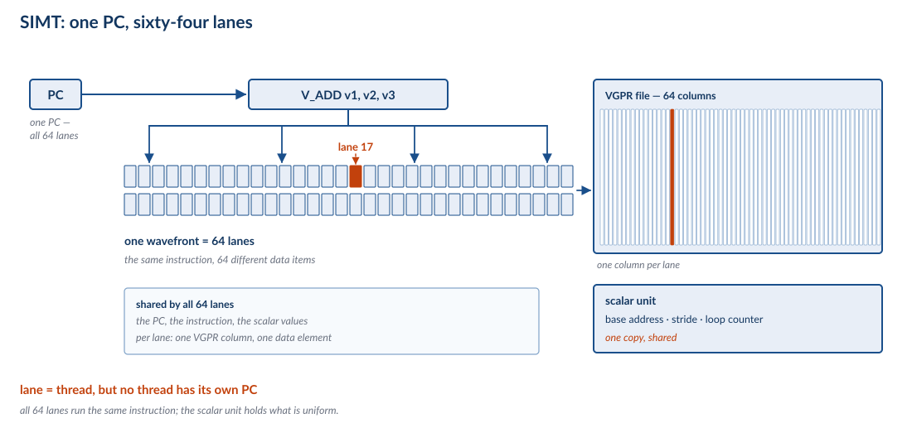{height=340px}

Sixty-four lanes share **one program counter**. One fetch, one decode, one
issue — 64 lanes wide.

- A **wavefront** is the 64 lanes that move together. (NVIDIA calls it a *warp*
  and makes it 32; RDNA can do either.)
- Every lane has its **own registers**, and executes the same instruction on
  different data.
- An **exec mask** says which lanes are currently active.

::: {.fragment}
This is **SIMT** — single instruction, multiple threads. The instruction stream
is shared; the *state* is not. That is the trick that makes 3,840 lanes
affordable.
:::

::: {.notes}
Draw the fan-out: one PC, 64 register columns, one instruction.

The name matters. SIMD (the vector unit) and SIMT (the GPU) both issue one
instruction over many lanes; the difference is what the programmer is allowed to
see, and that is the next-but-two slide.

NVIDIA's warp is 32 because their lanes are 32 wide; AMD's wavefront is 64 on
GCN and Vega. Same idea, different width. Do not let students think "warp" is the
general term.
:::

## The Register File, Drawn {.smaller}

Every lane needs its own registers, because every lane is working on a different
element.

- **Vector registers (VGPRs):** 64 columns, one per lane. This is where the
  256 KB per CU goes.
- **Scalar registers (SGPRs):** one copy, shared by the whole wavefront. Holds
  the things that are the *same* for all 64 lanes — the base address, the stride,
  the loop counter.

::: {.fragment}
That split is the architecture. The compiler's job is to keep as much as possible
in scalar registers, because a scalar value costs 1/64th of a vector value.
:::

::: {.notes}
This is the slide that makes the 256 KB register file make sense. It is not one
big register file — it is 64 small ones side by side, plus a shared scalar strip.

Good concrete example: in `c[i] = a[i] + b[i]`, the pointers `a`, `b`, `c` and
the index `i` are *scalar* — identical for all 64 lanes. Only the loaded values
are vector. A compiler that got this wrong would use 4× the registers and halve
occupancy.
:::

## Divergence {.smaller}

Now put a branch in the loop:

```c
for (int i = 0; i < n; i++)
    c[i] = (a[i] > 0) ? a[i] : -a[i];
```

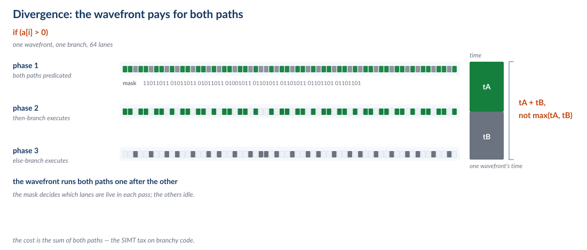{height=300px}

::: {.fragment}
The 64 lanes do not agree. Some want the `then` path, some the `else`. The
hardware cannot run both at once, so it runs **one path with the mask on, then
the other with the mask off**.
:::

::: {.notes}
Walk the figure: the mask starts all-ones, the branch splits it into two
disjoint masks, and each phase runs with the other lanes predicated off.

Key point: the inactive lanes are not stalled — they are *there*, burning the
same slot. They just do not write their results.

This is the GPU's version of a hazard, and it is the one students will meet most
often in practice. Anything data-dependent — a clamp, a collision test, a
termination condition — diverges.
:::

## What Divergence Costs {.smaller}

| | Cost |
|---|---|
| CPU mispredicted branch | flush the pipeline — ~15 cycles, once |
| GPU divergent branch | **run both paths — tA + tB, not max(tA, tB)** |

A 64-way `switch` on a data-dependent value can serialise a wavefront **64×**.

::: {.fragment}
So the GPU trades a *rare, bounded* penalty (misprediction) for a *common,
unbounded* one (divergence). That is the price of not having a predictor.
:::

::: {.notes}
This is the single most practically important consequence in Part II, and it is
where the "breaks when" row from the Two Bets table pays off.

The mitigation is architectural: arrange the data so that lanes agree. Sort
before you branch; partition into homogeneous work; make the common case
uniform. This is why GPU code often looks like it is avoiding `if` statements —
it is.

The 64× figure is the worst case where every lane takes a different arm. Real
code is usually much better, which is exactly why the bad cases are surprising.
:::

## Archaeology: The Goodyear MPP {.smaller .arch}

Massively Parallel Processor, 1983. Built for NASA Goddard to process Landsat
satellite imagery.

| | MPP |
|---|---|
| Processing elements | **16,384**, one bit each |
| Shape | 128 × 128 array |
| Workload | satellite images |
| Clock | **10 MHz** |
| Control flow | none per element |

::: {.fragment}
This is a GPU doing a GPU's job — forty years early. The demand for a throughput
machine did not appear in 2006; it appeared as soon as there were more pixels
than a CPU could chew.
:::

::: {.notes}
**Archaeology slide — not examinable.**

The MPP is the answer to "why do we even want this machine?" It was not built for
games or neural nets. It was built because Landsat was producing satellite images
faster than they could be processed, and image processing is embarrassingly
parallel — exactly the workload shape a GPU would later be built for.

Note the shape: 128 × 128 with a one-bit ALU, and the array physically matched
the image grid. When the data structure and the machine's topology agree, you get
the CM-2's best case.

The interesting claim to make: the *workload* is older than the hardware by four
decades. What changed in 2006 was not that someone discovered parallelism — it
was that a mass-market product (graphics) finally paid for the silicon.
:::

## SIMT vs Vectors {.smaller}

The C906 on our own boards has **RVV** vector instructions. A GPU has **SIMT**.
They look similar and are not the same.

| | **Vector (RVV)** | **SIMT** |
|---|---|---|
| One instruction, N lanes | yes | yes |
| One PC | yes | yes |
| Programmer sees the lanes | **yes** — `vl`, `vsetvl` | **no** — each lane looks scalar |
| Per-lane registers | shared vector registers | **private VGPRs** |
| Divergence | explicit masks, programmer's job | automatic, hidden, costly |

::: {.fragment}
A vector unit is **one thread doing N things**. SIMT is **N threads that happen
to move together**. The code you write for each looks completely different.
:::

::: {.notes}
This is the slide that connects the deck to the hardware on their desks. The
C906 has RVV 0.7.1, so they can write a vector loop and watch the same lane
concept behave differently.

The practical difference: in RVV you write a loop over a vector *register*, and
you can see the width. In SIMT you write a scalar program and the hardware
decides the width from the block size. That is why CUDA code has no explicit
vector type.

The divergence row is the interesting one: RVV lets the programmer reason about
masks explicitly; SIMT hides them, which is friendlier until it is expensive.
:::

## What We Bought, What We Paid {.smaller}

**Bought**

- Scalar-looking source code that runs **64 lanes wide**.
- No vector types, no `vsetvl`, no manual widening.
- The same program scales from a laptop iGPU to a server card by changing the
  block count.

**Paid**

- **Divergence** — data-dependent control flow serialises.
- You must think in **wavefronts**: block sizes that are not multiples of 64
  waste lanes on the last wave.
- Debugging is by wavefront, not by thread.

::: {.fragment}
> SIMT is the most successful lie in computer architecture: it convinces the
> programmer they are writing scalar code, and then runs it 64-wide.
:::

::: {.notes}
The block-size point is worth a concrete number: launch 100 threads on 64-wide
hardware and you get two waves, the second of which is 36/64 empty. That is 22%
of the machine doing nothing, from a one-line mistake.
:::

## End of Lecture 1 {.smaller}

What we established:

1. **The bet.** A GPU spends its area on concurrency instead of latency.
2. **Little's Law.** Threads = latency ÷ work. That is the whole design — and it
   is why thread *depth* matters more than SIMD width.
3. **SIMT.** 64 lanes share one PC; divergence is the price of not having a
   predictor.
4. **Four attempts, one winner.** Itanium, T2 and Knights Landing each got one
   axis right. The GPU got both, and promised nobody compatibility.
5. **The workload decides.** Graphics supplied the parallelism for free.

::: {.fragment}
**Lecture 2 asks the obvious next question:** fine — so how do you actually build
one of these? From a single compute unit to a whole card.
:::

::: {.notes}
End here. The five claims are the examinable summary of Lecture 1; the archaeology
slides in this lecture were not.

If you have time for one question, ask: *why did KNL fail when it had width,
threads and x86?* The answer is the depth number, and it is the whole lecture in
one sentence.
:::

# Part III — Memory, Inverted

## The Hierarchy, Inverted {.smaller}

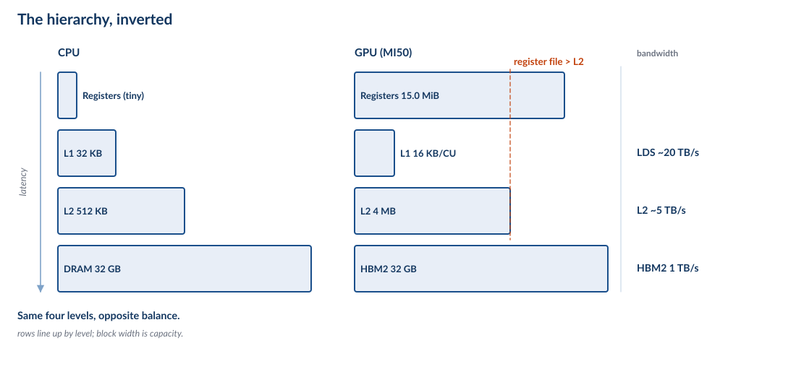{height=330px}

| Level | CPU (Zen 5) | GPU (MI50) |
|---|---|---|
| Registers | ~2 KB | **15.0 MiB** |
| L1 | 32–48 KB | 16 KB × 60 CUs = 960 KB |
| L2 | 1 MB | 4 MB |
| Last level | DRAM | HBM2, 32 GB |

::: {.fragment}
The register file is **nearly four times the L2**. On a CPU, registers are a
rounding error next to the caches. On a GPU they are the largest structure in
the core.
:::

::: {.notes}
This slide is the one that makes the memory deck's model stop working, and it is
worth being explicit about that: the *ordering* of the levels is the same, but
the *proportions* are nothing like a CPU's.

The reason is Part I: registers are where you keep the state of threads you are
not currently running. On a CPU that state lives in the OS and the stack. On a
GPU it lives in the register file, because a context switch has to be free.

Say the number: 15.0 MiB of register file versus 4 MB of L2. If you asked a CPU
designer to spend that area they would build a much bigger L2.
:::

## Expose or Hide? {.smaller}

The memory deck asked this question about the hierarchy and answered *hide* — a
cache decides what to keep, in hardware, invisibly.

The GPU answers **expose**.

| | Cache | Scratchpad |
|---|---|---|
| Who decides what is resident | hardware | **software** |
| Policy | LRU, FIFO, random | whatever the programmer wrote |
| Predictability | statistical | **exact** |
| Size on MI50 | 16 KB L1 | **64 KB LDS per CU** |

::: {.fragment}
With 40 wavefronts competing, a hardware policy thrashes. Staging explicitly is
slower to write and faster to run — and, crucially, **predictable**.
:::

::: {.notes}
This is a deliberate callback to the "Expose or Hide?" slide in the cache deck,
and it is the single best example of the GPU's design philosophy: move the
decision to the programmer, because the programmer has more information.

The LDS (local data share) is 64 KB per CU, shared by all wavefronts on that CU.
You use it exactly like a manually-managed cache: load a tile, compute on it,
synchronise, repeat. It is the ancestor of every tiling optimisation in the
course's later labs.

The cost is real: get the staging wrong and you are slower than the naive
version. That is the trade for predictability.
:::

## Archaeology: Cell {.smaller .arch}

Sony/Toshiba/IBM, 2005. "Expose" taken to its limit — and shipped in a games
console.

| | Cell BE |
|---|---|
| Cores | 1 PowerPC PPE + **8 SPEs** |
| Per SPE | **256 KB local store, no cache** |
| Data movement | explicit **DMA** in and out |
| SIMD width | 128-bit |

::: {.fragment}
Every load and store is a DMA you wrote yourself. This is the LDS argument from
the previous slide, with the cache deleted rather than demoted.
:::

::: {.notes}
**Archaeology slide — not examinable.**

Cell is the cleanest historical proof of the "expose, don't hide" claim, because
it went further than any GPU: the SPEs have no cache *at all*, only a 256 KB
scratchpad, and all data movement is explicit DMA. You do not get a cache miss;
you get a DMA you forgot to issue.

It shipped in the PlayStation 3 — which used **seven of the eight SPEs**, one
being disabled for yield — so students have a hook. And it is a good
example of a design that was technically admired and commercially painful: the
programming model was so demanding that most PS3 titles used only the PPE and
left the SPEs idle.

That is the same failure the GPU would have had — except the GPU had no
alternative but to make it work, because graphics was the only thing it did.

Worth noting: the SPEs were 128-bit SIMD with 128 registers, so the "wide and
shallow" critique applies here too.
:::

## The Third Tier: GTT {.smaller}

A CPU has DRAM. A GPU has DRAM **and** a way to make system memory look like its
own.

- The GPU has **its own page tables** — its own MMU, independent of the CPU's.
- So the driver can map **system pages into the GPU's address space**.
- That mapping is the **GTT** (graphics translation table).

::: {.fragment}
On a **discrete** card the GTT path crosses PCIe. That makes it the *spill*
path — the place data goes when it does not fit in VRAM, at a fraction of the
bandwidth.

On an **APU** there is no bus between the two page-table hierarchies. The GTT
path is the same fabric, so it is free.
:::

::: {.notes}
This is the tier a CPU does not have, and it is the mechanism behind the phrase
"unified memory". It is not a driver feature — it is the GPU's MMU pointing at
pages the CPU also uses.

The framing to land: unified memory is not "we made the GPU see system RAM".
GPUs could always see system RAM through the GTT. Unified memory is that the
*two page tables are kept in sync* so the same pointer works on both sides.

On a discrete card this is why a 4 GB card can run a 6 GB model — slowly. The
data spills through the GTT over PCIe. On an APU the same spill costs nothing,
which is the next-but-one slide.
:::

## The Bandwidth Ladder {.smaller}

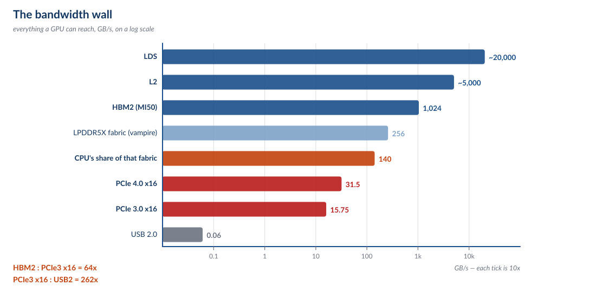{height=260px}

| Boundary | Width |
|---|---|
| Shared memory → lanes | ~13,000 GB/s |
| L2 → CU | ~5,000 GB/s |
| HBM2 → L2 | 1,024 GB/s |
| LPDDR5X fabric (vampire) | 256 GB/s <span class="quoted">spec</span> |
| CPU's share of that fabric | **~140 GB/s** <span class="measured">measured</span> |
| PCIe 4.0 x16 | 31.5 GB/s |
| PCIe 3.0 x16 | 15.75 GB/s |
| USB 2.0 | 0.06 GB/s |

::: {.fragment}
Every *bandwidth* number in Lecture 2 is one of these rows. The **64×** between HBM2 and
PCIe is the most important one, and Part V is about where it comes from.
:::

::: {.notes}
Put this ladder on the board and leave it there for the rest of the deck.

The two rows to comment on: the CPU's 140 GB/s is *measured on vampire* and is
less than the fabric behind it — that is its own slide in a moment. And USB 2.0
at the bottom is the sg2000's best off-chip link, which is why it has no GPU.

Do not let students memorise the ladder. The point is the *shape*: five orders
of magnitude, and every program is limited by the narrowest row it must cross.
:::

## Coalescing {.smaller}

A wavefront issues one load instruction. Sixty-four lanes each want 4 bytes.
**What addresses do they want?**

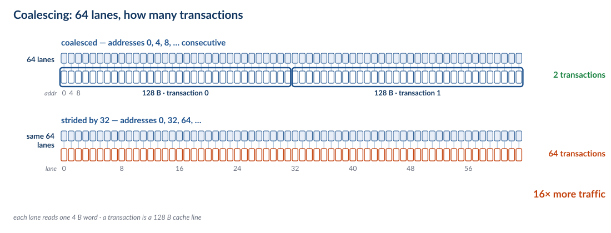{height=330px}

| Pattern | Transactions | Efficiency |
|---|---|---|
| 64 consecutive floats | **2 × 128 B** | 100% |
| stride 32 floats | **64 × 64 B** | 6.25% |

::: {.fragment}
The hardware coalesces the 64 lane addresses into as few cache-line transactions
as it can. Consecutive is perfect; strided is catastrophic.
:::

::: {.notes}
The numbers: 64 lanes × 4 B = 256 B of useful data. Consecutive, that is four
64-byte lines, fetched as two 128-byte transactions. Strided by 32 elements
(128 B), every lane lands in a different line, so you fetch 64 lines to use 4
bytes from each.

This is the GPU's version of the memory deck's block-size material, and it is
the single most common performance bug in real GPU code. Array-of-structs versus
struct-of-arrays is not a style choice here — it is a 16× difference.
:::

## Why Coalescing Is Block Size {.smaller}

In the cache deck, block size was a tradeoff: bigger blocks exploit spatial
locality, and cost you on a miss.

On a GPU, **the wavefront is the block**.

| | CPU cache | GPU wavefront |
|---|---|---|
| Unit of access | cache line (64 B) | 64 lanes × their element |
| Decided by | hardware, fixed | **the code the programmer wrote** |
| Mispredict costs | one wasted line | **64 wasted transactions** |

::: {.fragment}
The block-size decision did not disappear. It moved from the cache designer to
the programmer — and it is now made by *how you lay out your data*.
:::

::: {.notes}
This is the slide that ties Part III back to the memory deck, and it is worth
being precise: the hardware still has a 64-byte line, and it still fetches whole
lines. What changed is that the *access pattern* is now a programmer-visible
choice with a 16× range.

So "block size" is no longer a knob in a config register. It is a property of
your struct layout, your loop order, and your thread mapping. That is a
significant shift in where the optimisation lives, and it is why GPU programming
is a data-structure discipline as much as an algorithm one.
:::

## Occupancy {.smaller}

How many wavefronts can a CU hold? It is a division problem.

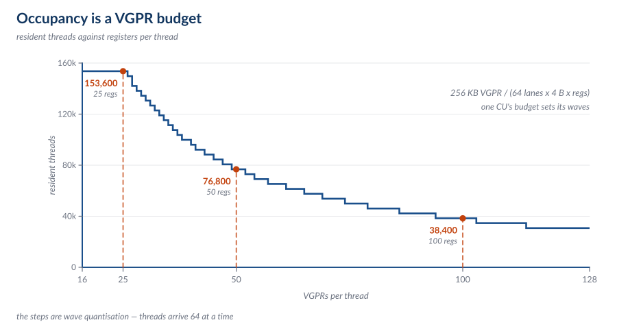{height=240px}

::: {.eq}
256 KB of VGPR ÷ (64 lanes × 4 B × registers-per-thread)
:::

| Registers per thread | Resident wavefronts | Resident threads |
|---|---|---|
| 25 | 40 | **153,600** |
| 50 | 20 | 76,800 |
| 100 | 10 | 38,400 |

::: {.fragment}
Every register you spend on one thread is a thread you cannot hold. That is the
GPU's version of AMAT — one equation that every optimisation moves.
:::

::: {.notes}
Do the arithmetic on the board: 256 KB / (64 × 4 × 25) = 40 wavefronts. Then
show that doubling the registers halves the wavefronts, and so on. It is exact,
and students can check it.

This is the analogue of the AMAT slide in the memory deck, and it should be
presented the same way: here is the equation, here are three worked points, now
every mechanism in the rest of the lecture moves one term.

The tuning dial this creates is real: fewer registers per thread means more
occupancy means more latency hiding, but it also means more spilling to memory.
The compiler's register budget is a performance parameter you can set.
:::

## Half the Memory Is Not for the CPU {.smaller}

vampire has a **256 GB/s** memory interface. The multicore notes already called
this machine "really weird — quad channel DDR5, but only for the integrated
graphics." Let us put a number on it.

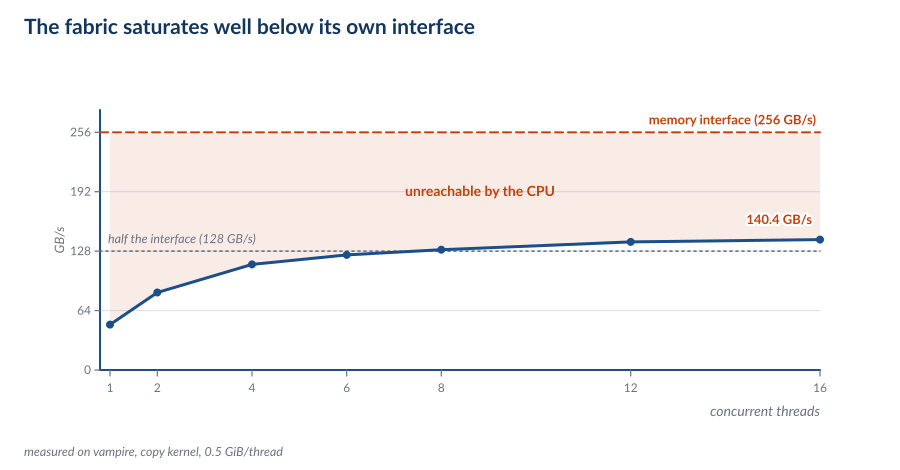{height=310px}

| Threads | 1 | 2 | 4 | 8 | 16 |
|---|---|---|---|---|---|
| GB/s | 48.9 | 83.5 | 113.7 | 129.6 | **140.4** |

::: {.fragment}
The CPU saturates at **~140 GB/s** — about 55% of the interface — and stops.

Two stories fit: the CPU gets **half the channels**, or its **fabric link** to
the memory controller is narrower than the controller. 140 against 128 is within
10%, so this measurement does not separate them.
:::

::: {.notes}
This is a measured slide. Run it live if you can: it is twenty lines of Python
with a `threading.Barrier`, and it works on any machine in the room.

Be scrupulous here, because it is the easiest slide in the deck to overclaim. The
measurement says: the CPU cannot reach more than ~140 GB/s of a 256 GB/s
interface. It does *not* say why. "Two of the four channels" predicts 128;
"narrower fabric link" predicts something in the same neighbourhood. Both fit.

The fabric link is the likelier story — the memory controller has the full width,
and the iGPU sits in the same die as the controller while the CPU cores are on
separate dies behind an interconnect. But that is an argument, not a measurement.

How you would settle it: count the memory-controller channels in sysfs or the
ACPI tables, or measure the iGPU's copy bandwidth and see whether *it* reaches
256 GB/s. Either experiment would separate the two stories. Say that out loud —
it is a better lesson than the conclusion.

What does survive either way: on this machine the accelerator is the
bandwidth-privileged client and the CPU is the poor relation, which inverts the
usual relationship between a CPU and its accelerators. And the bottleneck is a
*link*, which is what the rest of this deck is about.
:::

## Unified Memory: When the Bus Isn't There {.smaller}

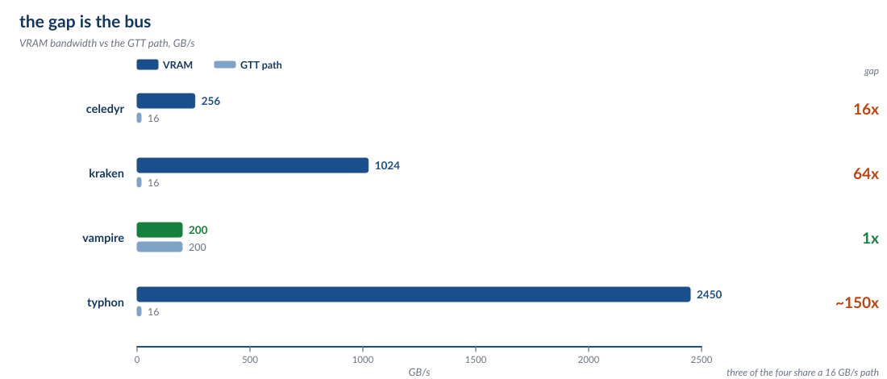{height=330px}

On vampire:

| | |
|---|---|
| Physical LPDDR5X | ~128 GiB |
| Carved out as VRAM | **16 GiB** |
| Visible to Linux | 109.7 GiB |
| GTT aperture | **104 GiB** |

::: {.fragment}
So the GPU can address about **120 GiB**, and allocating **~100 GiB** at runtime is
routine. On celedyr — 4 GiB of VRAM and a 256 MiB window at 16 GB/s — it is not
a plan, it is a weekend.
:::

::: {.notes}
This is the payoff of the GTT slide. The gap between VRAM and GTT *is the bus*:
16–64× on a discrete card, 1× on an APU. So "can I allocate 100 GiB on the GPU" has
a different answer on each machine, and the answer is set entirely by whether
there is a PCIe link in the middle.

The number that makes it concrete: `mem_info_vis_vram_total` is 16 GiB and BAR
Region 0 is 16 GiB. Same number, two subsystems, two commands. That is the BAR
slide in Part V arriving early.

The architectural statement: unified memory is not a software feature that
someone turned on. It is what you get when the two page-table hierarchies are on
the same side of the fabric.
:::

# Part IV — The Machine

## Build Up: One Compute Unit {.smaller}

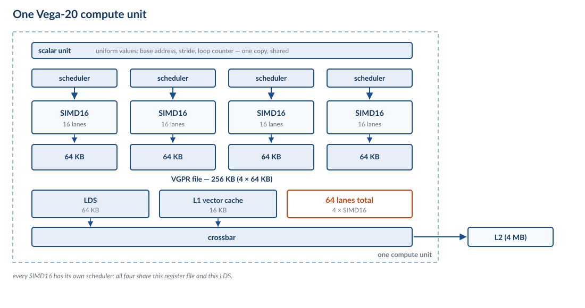{height=300px}

| Part | Vega 20 CU |
|---|---|
| Lanes | 4 × SIMD16 = **64** |
| Schedulers | 4, one per SIMD |
| Vector registers | **256 KB** (4 × 64 KB) |
| Shared memory | 64 KB LDS |
| L1 vector cache | 16 KB |
| Wavefronts resident | up to 40 (10 per SIMD) |

::: {.fragment}
Four independent schedulers is the key number: each picks a wavefront every
cycle, so the CU can issue from four different places at once.
:::

::: {.notes}
Build this on the board rather than reading the figure. Box, four SIMDs, four
schedulers, the register file behind them, LDS, L1.

The 10-wavefronts-per-SIMD limit is what produces the 40 in the occupancy
equation from Part III. It is a hardware limit, not a register limit — even with
free registers you cannot exceed 10 waves per SIMD.

Four schedulers matters because it is how the CU hides latency *within* a cycle:
if one wavefront stalls on a memory op, the scheduler for that SIMD picks a
different one, and the other three SIMDs are unaffected.
:::

## Build Up: The Shader Array {.smaller}

Sixteen CUs, wired together — and then four of those arrays make a GPU:

| | One shader array | The whole GPU (MI50) |
|---|---|---|
| Compute units | **16** | 4 arrays, **60 of 64 enabled** |
| Lanes | 1,024 | **3,840** |
| L2 | shared by all four arrays | 4 MB |
| Interconnect | crossbar | crossbar |
| HBM2 | via the memory controllers | 4 stacks, 8 controllers |

::: {.fragment}
Now the Part III numbers have somewhere to live: 60 CUs × 256 KB is the 15.0 MiB
register file, and 60 × 64 KB is 3.75 MiB of LDS — **nearly as much as the L2**.
:::

::: {.notes}
The "60 of 64 enabled" detail is worth a sentence: MI50 is MI60 with four CUs
lasered off, which is how chip vendors sell a partially-good die. It is also why
"how many CUs does a Vega 20 have" has two right answers.

The LDS total is a good number to have ready: 60 CUs × 64 KB = 3.75 MiB of
software-managed scratchpad, against 4 MB of hardware-managed L2. The GPU ships
almost as much programmer-managed memory as cache. That is the "expose" decision
from Part III expressed in silicon area.

The crossbar is worth naming because it is where the L2 bandwidth comes from, and
it is the boundary from the fabric table — the "L2 → CU, ~5 TB/s" row.
:::

## Build Up: The Whole Card {.smaller}

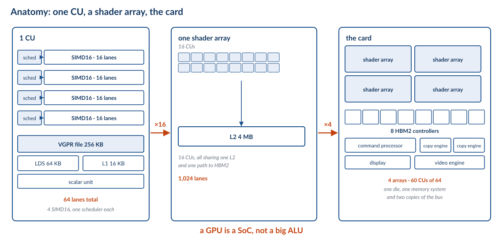{height=260px}

A GPU is not a big arithmetic unit. It is a **computer**:

| Block | Job |
|---|---|
| Shader array | the 60 CUs |
| Memory controllers | 8 × HBM2 |
| Command processor | takes work from the host |
| Copy engines (2) | DMA between VRAM and system memory |
| Display (DCN) | scanout to the monitor |
| Video (VCN) | H.264/H.265 encode and decode |

::: {.fragment}
Only one of those six blocks does the arithmetic we have spent three parts
building up to. The rest is a system on a chip.
:::

::: {.notes}
This is the punchline of Part IV and it should land hard: students have spent
three parts learning about lanes and wavefronts, and the shader array is one box
out of six.

The copy engines deserve a mention now because they come back in Part V: they are
the DMA engines that move data across PCIe. When you copy a buffer to the GPU,
the CPU is not doing it — a copy engine is.
:::

## A GPU Is a SoC {.smaller}

You have met this pattern before. The sg2000 is `2 × C906 + A53 + 8051` plus a
pile of engines. A GPU is the same shape with a much larger shader array.

| sg2000 engine | GPU equivalent | Job |
|---|---|---|
| TPU | shader array | the arithmetic |
| VPU (H.264/H.265) | **VCN** | video codec |
| JPEG | **JPEG** | still image |
| SDMA | **copy engines** | data movement |
| display/VPSS | **DCN** | scanout, scaling |

::: {.fragment}
> The engine zoo is the normal shape of a modern chip. What makes a GPU a GPU is
> that its "engine" is **programmable**.
:::

::: {.notes}
This is a deliberate callback to the "Engine Zoo" slide in the Beyond the CPU
deck. The point is that the *architecture* is the same — a control core plus a
set of fixed-function dataflow engines — and the only difference is that one of
the engines on a GPU can be programmed.

That reframing is useful for the next lecture: a GPU is not exotic, it is the
specialisation pattern we already studied, with the specialisation made general.
:::

## Archaeology: GreenArrays {.smaller .arch}

GA144, 2011. The one design point with **no clock tree at all**.

| | GA144 |
|---|---|
| Cores | **144**, each an independent asynchronous computer |
| Clock | **none** — each node runs when a neighbour gives it work |
| Per node | 18-bit stack machine, 64 words RAM + 64 words ROM |
| Power | **14 µW to 650 mW**, depending on activity |
| Language | arrayForth |

::: {.fragment}
Compare the sg2000: one 25 MHz crystal, eight PLLs, ninety leaf clocks, ~3 W.
GreenArrays deleted the tree — power is spent only where data actually moves.
:::

::: {.notes}
**Archaeology slide — not examinable.**

This is the counterpoint to the clocks material in the Beyond the CPU deck. The
sg2000 has one crystal, eight PLLs and about ninety gated leaf clocks, and every
one is a decision someone made. GreenArrays made a different decision: no clock,
144 nodes in an 18 × 8 array, each of which wakes when a neighbour hands it a
value, computes, and goes back to sleep.

The power range is the number to land: **14 microwatts to 650 milliwatts**, set
entirely by how much data is moving. That is three orders of magnitude below the
sg2000, and it is what "power scales with data movement, not with frequency"
looks like in silicon.

Each node has 64 words of RAM and 64 words of ROM. Sixty-four words. Programs
have to be *spread across nodes* and communicate by blocking reads and writes to
neighbours, which means you route messages by hand and can deadlock yourself.

Designed by Chuck Moore, who invented Forth, and programmed in arrayForth, which
he also designed. The chip and the language were built for each other, which is
either beautiful or a warning sign depending on your taste.

The teaching point is narrow and real: **there is nothing inevitable about a
clock tree.** It is a design choice with a power cost, and one shipping chip
declined to pay it.
:::

## The Command Processor {.smaller}

How does the CPU tell the GPU to do something? Not by calling a function.

1. The driver builds a **command buffer** in memory: draw calls, dispatches,
   buffer addresses, all as packets.
2. It writes the buffer's address into a **ring buffer** the GPU is watching.
3. It writes a **doorbell** — a single MMIO store that says "there is new work".
4. The GPU's command processor reads the packets and dispatches them.
5. A **fence** (a memory write the GPU performs) tells the CPU the work is done.

::: {.fragment}
Notice: the CPU never touches the data. It writes a *description* of the work,
rings a bell, and the GPU's own DMA engines move the bytes.
:::

::: {.notes}
This is the power deck's DMA pattern, one level up: instead of one descriptor,
you have a ring of command packets.

The doorbell is worth dwelling on because it is the single most important
interface in the whole machine: one MMIO write, and it crosses PCIe. In Part V we
will look at what that costs.

The fence is the other half: the GPU cannot interrupt the CPU for every packet,
so it writes a known value to a known address and the CPU polls it. That is a
coherent write across PCIe, which is exactly the thing PCIe does not give you for
free.
:::

## The GPU's Own MCU {.smaller}

A GPU has a small computer inside it whose only job is to manage the big one:

- **RLC** — runs the scheduler, handles preemption, manages power states.
- **MEC/ME** — the microcode engines that dispatch wavefronts to CUs.
- It handles the doorbell, and it keeps running when the shader array is idle.

::: {.fragment}
This is the sg2000's **always-on island** pattern again: a tiny, always-powered
microcontroller that supervises the part that costs real power.
:::

::: {.notes}
Same idea as the 8051 in the sg2000's RTC domain, and the same reason: the big
array cannot be trusted to supervise itself, and something has to be awake to
answer the doorbell.

Practical consequence students will hit: GPU firmware is a real thing. A
`amdgpu` driver load that fails on firmware is failing to start this MCU, not the
shader array. That is why "no firmware" produces a card that enumerates on PCIe
but does nothing.
:::

## Seven Machines, Seven Answers {.smaller}

| Machine | Accelerator | Attach | Memory | Bandwidth |
|---|---|---|---|---|
| **sg2000** | none (TPU/VPU/ISP) | on-die | carveouts of 512 MB | 3.73 GB/s |
| **celedyr** | Polaris 10 · 2016 | PCIe slot | 4 GiB GDDR5 | ~256 GB/s |
| **kraken** | 4 × Vega 20 · 2018 | 4 PCIe slots | 32 GiB HBM2 each | 1,024 GB/s |
| **typhon** | 8 × Gaudi2 · 2022 | 2 sockets × 2 switches | 96 GiB HBM2e each | 2,450 GB/s |
| **unicorn** | RX 7600 · 2023 | PCIe slot | 8 GiB GDDR6 | ~288 GB/s |
| **vampire** | Radeon 8060S · 2025 | on-die, **still a PCIe endpoint** | 16 GiB + 104 GiB GTT | ~256 GB/s |
| **pegasus** | Arc Battlemage · 2025 | PCIe slot | 32 GiB | n/m |

::: {.fragment}
Nine years separate celedyr from pegasus, and the **attach** column barely
changed: on-die, or a slot. What changed is the memory behind the BAR — and how
much of it you are allowed to see.
:::

::: {.notes}
This is the equivalent of the memory deck's "Four Cores, Four Answers" and it is
the slide to photograph. It is ordered by year on purpose, so the class can see
that the attachment mechanism has been stable for a decade while the memory has
not.

`n/m` means *not measured* — pegasus's memory bandwidth is the one number here I
do not have, and inventing it would be worse than the gap. Worth saying out loud:
a table with one honest hole in it is more trustworthy than a complete one.

The zero in the sg2000 row is not a typo: it has accelerators, but not one of
them is a general-purpose shader array. That is a design choice with a reason,
and Part V's counterfactual is about that reason.

Flag the vampire row: the iGPU is *integrated* and still shows up on the PCI bus.
That is the hook for Lecture 2. And flag that pegasus, the newest machine in the
table, is the newest of the two with a full 32 GiB window — which the BAR slide explains.
:::

## Why the iGPU Is Still a PCI Device {.smaller}

On vampire, the integrated GPU — no slot, no cable, same die as the CPU — appears
in `lspci` as:

```text
be:00.0 Display controller: AMD/ATI Device 1586
    Region 0: Memory at 8000000000 (64-bit, prefetchable) [size=16G]
    Kernel driver in use: amdgpu
```

::: {.fragment}
Because **PCI configuration space is the only standard way an operating system
discovers a device and maps its registers**. Integration changes the physics, not
the protocol.
:::

::: {.notes}
This is the transition to Lecture 3 and it should be presented as a puzzle: why
would an on-die GPU need a bus address?

The answer is that "PCIe" is two things — a physical link and a *configuration
protocol* — and the iGPU needs only the second. It is enumerated like a card
because that is how drivers, firmware, and the kernel agree on where the
registers are.

That distinction (link versus protocol) is the thing to carry into Part V.
:::

## End of Lecture 2 {.smaller}

What we established:

1. **The hierarchy is inverted.** Registers above L2, and the programmer manages
   the middle.
2. **GTT is the tier a CPU does not have.** GPU page tables can point at system
   memory — which is unified memory, and which is free only when there is no bus
   in between.
3. **Occupancy is the AMAT.** `256 KB ÷ (64 × 4 × regs)`. Every optimisation
   moves that one number.
4. **A GPU is a SoC**, and the shader array is one block of six.
5. **The command processor is the interface.** Doorbell, packets, fence — the CPU
   never touches the data.

::: {.fragment}
**Lecture 3 starts with a question this lecture raised:** if the iGPU is on the
same die as the memory controller, why does it still need a bus address — and
what does a *real* bus cost when there is one?
:::

::: {.notes}
End here. The five claims are the examinable summary of Lecture 2.

Do not preview the PCIe material in detail — just leave the question. Students
who go away thinking "why does the integrated GPU have a PCI address" will come
back for Lecture 3.
:::

# Part V — PCI and PCIe

## Why a Bus at All {.smaller}

The sg2000 has no bus. Every peripheral is **on the die**, memory-mapped, and
described to the kernel by the device tree:

```text
uart0: serial@04140000 { compatible = "snps,dw-apb-uart"; reg = <0x0 0x04140000 ...>; };
```

That works beautifully — until the thing you want to attach is **too big to be on
the die**.

| | Die area |
|---|---|
| SG2000 (4 cores + engines) | small, and it is a ~3 W part |
| One MI50 GPU | 331 mm² of shader array, plus 4 HBM2 stacks |

::: {.fragment}
So the GPU must be **off-chip**. And the moment a device is off-chip, you need
two things you did not need before: a **physical link**, and a way to **find it**.
:::

::: {.notes}
This is the framing slide for the whole of Lecture 3, and it is worth slowing
down for.

The device tree callback is deliberate — they saw it in the boot deck, where the
point was that embedded SoCs have *non-discoverable* peripherals. That is fine
when the set of peripherals is fixed at design time. It stops being fine when you
want to plug something in.

So the question Part V answers is: what does the industry use instead, and what
does it cost?
:::

## PCI, 1992 {.smaller}

The Peripheral Component Interconnect: a **shared parallel bus**.

| | PCI |
|---|---|
| Width | 32 or 64 bits, parallel |
| Clock | 33 or 66 MHz |
| Bandwidth | **133 MB/s** (32/33), 533 MB/s (64/66) |
| Topology | **every device on the same wires** |
| Arbitration | central — one device transmits at a time |

::: {.fragment}
Shared wires are the whole design and also the whole problem: **one device talks
at a time**, and everyone's bandwidth is everyone else's.
:::

::: {.notes}
The 133 MB/s figure is worth putting next to the ladder from Part III: it is
the same order as the sg2000's USB 2.0 link. PCI was a huge improvement in 1992
and is slower than a single SATA port today.

Arbitration is the concept students need: a shared bus is a broadcast medium, so
somebody has to decide who talks. That decision costs cycles and adds latency,
and it gets worse with more devices — which is the opposite of what you want.
:::

## PCI's Two Good Ideas {.smaller}

PCI died. Two of its ideas did not, and they are why we are still living with its
successor.

**1. Configuration space.** Every device has 256 bytes of standard registers
holding its vendor ID, device ID, class, and — crucially — its **BARs**. The OS
can *walk the bus* and find out what is there.

**2. Base Address Registers.** A device says "I need N bytes of address space".
The OS assigns it an address. The device's registers then appear in the CPU's
**physical address map**.

::: {.fragment}
That is **enumeration** — the exact opposite of a device tree. The device
announces itself; the OS does not need to be told in advance.
:::

::: {.notes}
These two ideas are the reason this part of the lecture exists. Everything else
about PCI is history; config space and BARs are load-bearing today.

The contrast with the device tree is the intellectual content: a device tree is a
*static description written by a human*, and config space is a *dynamic
description written by the device*. Both solve "how does the OS know where the
registers are", and they make opposite tradeoffs.

This is also why the sg2000's device tree is enormous and a PC's is not: on a PC,
almost everything that matters is discoverable.
:::

## PCIe, 2003 {.smaller}

PCI Express throws out the shared bus and keeps the two good ideas.

| | PCIe |
|---|---|
| Topology | **point-to-point** — every device has its own link |
| Signalling | serial, **lanes** (1, 2, 4, 8, 16) |
| Duplex | **full** — transmit and receive simultaneously |
| Unit of transfer | **packets** (TLPs), not bus cycles |
| Hierarchy | root complex → switches → endpoints |

::: {.fragment}
Because links are point-to-point, you can build a **tree**. Because you can build
a tree, you can put eight accelerators in one box without them fighting over
wires.
:::

::: {.notes}
The single most important change is point-to-point. It removes arbitration
entirely: nobody shares anything, so there is nothing to arbitrate.

Packets instead of bus cycles is the second change, and it is what makes lanes
composable — you stripe a packet across however many lanes you paid for.

Root complex is the term for "the thing in the CPU/chipset that speaks PCIe".
Students will see it in `lspci -t` output and in error messages; name it now.
:::

## Lanes and Generations {.smaller}

A lane is one serial link. You buy width by buying lanes.

| Generation | Per lane | ×4 | ×16 |
|---|---|---|---|
| PCIe 1.0 (2003) | 250 MB/s | 1 GB/s | **4 GB/s** |
| PCIe 2.0 (2007) | 500 MB/s | 2 GB/s | **8 GB/s** |
| PCIe 3.0 (2010) | ~1 GB/s | ~4 GB/s | **15.75 GB/s** |
| PCIe 4.0 (2017) | ~2 GB/s | ~8 GB/s | **31.5 GB/s** |
| PCIe 5.0 (2019) | ~4 GB/s | ~16 GB/s | **63 GB/s** |

::: {.fragment}
Put the ×16 column next to the Part III ladder: even **PCIe 5.0** is 16× slower
than the HBM2 on the card it is feeding. The bus was never going to keep up.
:::

::: {.notes}
These are per-direction figures; PCIe is full duplex, so a ×16 Gen3 link is
15.75 GB/s each way.

The key observation is the last one and it should be stated plainly: no
generation of PCIe has ever been close to on-card memory bandwidth, and the gap
has widened, not narrowed. That is not a failure of PCIe — it is why the
programming model looks the way it does.

Careful with units: these are GB/s (decimal) and marketing often quotes GT/s.
A Gen3 lane is 8 GT/s of signalling but ~985 MB/s of payload after encoding.
:::

## What a BAR Actually Is {.smaller}

A **Base Address Register** is how a device gets a window into the CPU's physical
address space.

1. The device says: "I need 256 MiB."
2. The OS assigns it an address — say `0xd0000000`.
3. Now a CPU store to `0xd0000000` is **a packet sent over PCIe to the device**.

::: {.fragment}
The BAR is not a copy of the device's memory. It is a **window** — an address
range that, when touched, generates bus traffic instead of hitting DRAM.
:::

::: {.notes}
This is the single most important mechanism in Part V, and it is worth drawing:
CPU physical address space on the left, a hole punched in it labelled "BAR", an
arrow out over PCIe to the card.

The consequence students should take away: reading a device register is not like
reading memory. It is a round trip over a link, and it can be hundreds of
nanoseconds. That is why drivers batch register writes.

Second consequence: the window can be *smaller than the device's memory*. That
is the next slide, and it is where things get interesting.
:::

## The BAR Is a Policy, Not a Generation {.smaller}

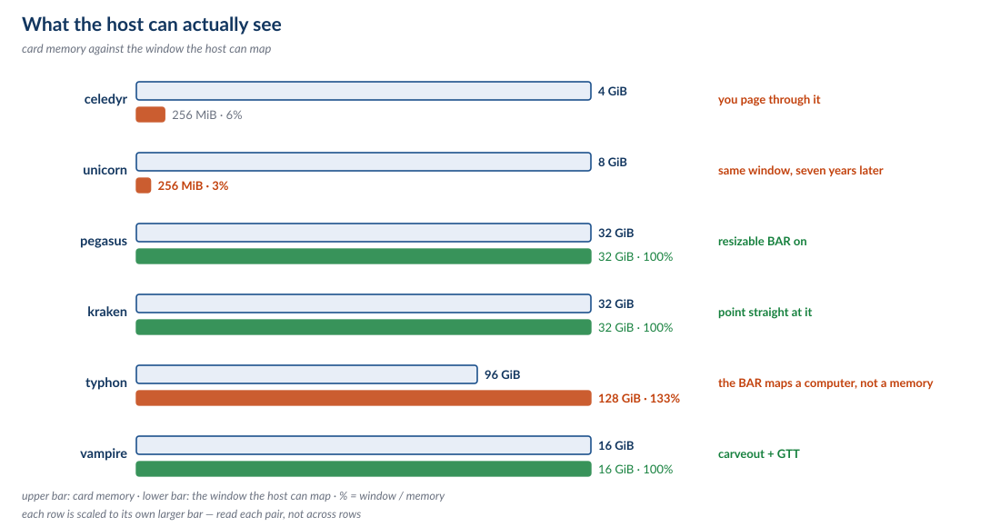{height=240px}

| Machine | Card | Year | Memory | BAR window | Visible |
|---|---|---|---|---|---|
| celedyr | Polaris 10 | 2016 | 4 GiB | **256 MiB** | 6% |
| unicorn | RX 7600 | 2023 | 8 GiB | **256 MiB** | **3%** |
| pegasus | Arc Battlemage | 2025 | 32 GiB | **32 GiB** | 100% |
| kraken | MI50 | 2018 | 32 GiB | 32 GiB | 100% |
| typhon | Gaudi2 | 2022 | 96 GiB | 128 GiB | 133% |
| vampire | iGPU | 2025 | 16 GiB carveout | 16 GiB | 100% |

::: {.fragment}
Look at the first two rows. A **2023** card ships with the same 256 MiB window as
a **2016** one — and because its memory doubled, the fraction you can see
*halved*. The window is a firmware setting, not a generation of the bus.
:::

::: {.notes}
This is the best table in the deck, and every row is measured on our own
machines.

One precision note on celedyr: its PCI ID is `1002:67df`, which covers the whole
Polaris 10 family — RX 470, 480, 570 and 580 — so "Polaris 10, 2016" is the most
specific claim the hardware supports. It is 4 GiB whichever SKU it is, which is
the number that matters here.

The unicorn row is the one that changes the story. I originally expected modern
cards to have full-VRAM windows and old ones to page. They do not: unicorn's
driver says so out loud in dmesg —

```text
amdgpu 0000:0c:00.0: Detected VRAM RAM=8176M, BAR=256M
```

— which is a 2023 RDNA3 card advertising a 256 MiB window over 8 GiB of memory.
That is *worse* than celedyr's 2016 ratio, because the memory doubled and the
window did not.

pegasus is the other extreme: an Intel Battlemage with a 32 GiB BAR and 32 GiB of
memory, so the whole card is mappable. Same PCIe generation family as the others,
opposite default.

So "resizable BAR" is the right name for it: a *policy*, negotiated at
enumeration, and firmware-dependent. That is why the same 64× wall behaves
differently on machines that look identical in a spec sheet.

celedyr's driver pages through its window — move a chunk in, use it, move the
next. typhon's 128 GiB BAR is bigger than its 96 GiB of HBM because the BAR also
maps control structures, doorbells and network queues: it fronts a *computer*,
not a memory. And that BAR sits at 0x11c000000000, about 19 TB up the address
space, which only works because PCIe has 64-bit BARs.
:::

## Topology on Our Machines {.smaller}

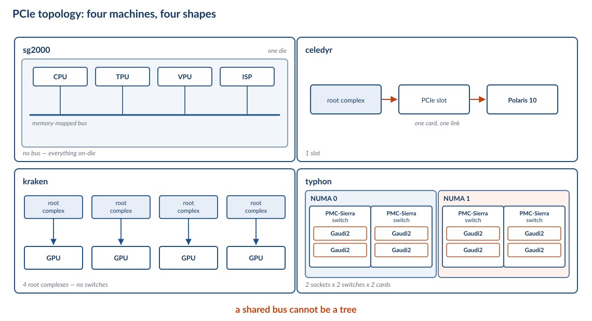{height=390px}

::: {.fragment}
Read the four panels left to right as a progression: **no bus**, **one link**,
**four links**, **a switch tree**. Each step is a design decision PCIe made
possible and PCI could not.
:::

::: {.notes}
Walk the panels.

The sg2000 has no bus at all — the "links" are on-die wiring, and the device tree
describes them.

celedyr is the minimum viable PCIe system: one root complex, one slot, one card.

kraken is four independent links, no switch. That is the simplest way to get four
GPUs and it is why each card gets full bandwidth.

typhon is the interesting one and it gets the next two slides.
:::

## Why a Switch Needs PCIe {.smaller}

typhon has eight accelerators, and they are not all on separate links:

```text
socket 0 ── root complex ── PCIe switch ─┬── Gaudi2
                                          └── Gaudi2
         └─ root complex ── PCIe switch ─┬── Gaudi2
                                          └── Gaudi2
socket 1 ── (same, four more cards)
```

::: {.fragment}
A switch forwards packets by address, exactly like a network switch. **You cannot
build this out of a shared bus** — a broadcast medium has no notion of "this
packet is for that device".
:::

::: {.notes}
This is the slide where PCIe's central design decision pays off visibly. A switch
requires point-to-point links and per-packet addressing; PCI had neither.

The topology is 2 sockets × 2 switches per socket × 2 cards per switch = 8. That
symmetry is deliberate — it exists so that no two cards on the same switch are
further apart than any other pair.

Practical point: this is why `lspci -t` on typhon shows four levels of depth and
on celedyr shows one. Same protocol, very different trees.
:::

## NUMA Is a PCIe Topology {.smaller}

The multicore lecture ended with an open question: *"Intel tries for less NUMA
nodes — ssh into typhon, can we figure this one out?"*

Here is the answer.

| | |
|---|---|
| CPU | 2 × Xeon Gold 6338N, 32 cores each |
| NUMA nodes | **2** (not 4 — Intel's answer to EPYC's four) |
| Cards 0–3 | NUMA node 0 |
| Cards 4–7 | NUMA node 1 |
| Distance between nodes | **20** (vs 10 local) |

::: {.fragment}
So NUMA is not only about memory locality. It is about **which root complex your
accelerator is behind** — and a GPU on the far node pays double.
:::

::: {.notes}
This closes a loop the students will remember from the multicore lecture, and it
is a genuine addition: the multicore deck could only ask the question, because
the answer requires knowing what the PCIe topology is.

The measurement is `cat /sys/bus/pci/devices/0000:19:00.0/numa_node` — one file
per card, and the four/four split falls straight out.

The general lesson: on a machine with accelerators, "NUMA aware" means
*accelerator aware*. Pinning a job to the wrong node costs you a hop through the
interconnect on every access, which is exactly the 10-versus-20 distance.
:::

## DMA over PCIe {.smaller}

The command-processor pattern from Part IV, now with a bus underneath it.

| Method | What the CPU does | Cost |
|---|---|---|
| Programmed I/O | copies every word | a bus round trip **per word** |
| Interrupt-driven | copies every word, sleeps between | still a round trip per word |
| **DMA** | writes a descriptor, rings a bell | one round trip **per transfer** |

::: {.fragment}
The copy engines do the moving. The CPU writes maybe 32 bytes of descriptor and
then goes away — which is the only way to use a link whose latency is measured in
hundreds of nanoseconds.
:::

::: {.notes}
This is the power deck's DMA material, one level out: instead of a descriptor
ring inside the SoC, you have one across a cable.

The arithmetic to put on the board: at ~1 µs of PCIe round-trip latency,
programmed I/O moving 4-byte words tops out at about 4 MB/s no matter how fast
the link is. DMA is not an optimisation here; it is the difference between
working and not.

The fence from Part IV belongs here too: completion is a coherent write the GPU
makes to host memory, and the CPU polls it.
:::

## Coherency Is Not Provided {.smaller}

PCIe moves data. It does **not** keep the CPU's caches in sync with it.

- The CPU's caches do not snoop PCIe writes.
- If a device DMAs into a buffer the CPU has cached, the CPU may read **stale
  data** — or its dirty lines may overwrite the device's work.
- PCIe has optional extensions (**ATS**, **PRI**) that help, and they are not
  free and not universal.

::: {.fragment}
So the driver does it by hand: **invalidate before the device writes, flush
before the device reads**. Every DMA driver you have ever read is doing this.
:::

::: {.notes}
This is the "Coherency Wrinkle" from the Beyond the CPU deck, now with a reason:
inside the SoC the interconnect is coherent, and across PCIe it is not.

The practical symptom students will meet: a buffer that is correct when
uncached, corrupt when cached. It looks like a hardware bug and is not.

On the sg2000 this problem is smaller than it looks: the little core runs in
M-mode with physical addressing and no page tables, so a buffer's physical
address is the address you use — which is what the physical-memory hint covers.
:::

## The Bandwidth Wall {.smaller}

| | |
|---|---|
| HBM2 on the card | **1,024 GB/s** |
| PCIe 3.0 ×16 to the card | **15.75 GB/s** |
| Ratio | **~65×** |

::: {.fragment}
That is the kraken number from Part III: the VRAM-versus-GTT gap on *that*
machine is 64×. Not a coincidence — **it is the same link.**
:::

::: {.fragment}
So the programming model is forced:

- **Batch** work, so one crossing amortises over many operations.
- **Keep data resident**, so you cross as rarely as possible.
- Never round-trip per element. Ever.
:::

::: {.notes}
This is the intellectual centre of Part V and it should be connected explicitly
to Part III. The "GTT cliff" and the "bandwidth wall" are one phenomenon seen
from two directions.

The consequence for programmers is the whole of Part VI: the reason you write
kernels over large arrays instead of calling a function per element is not
elegance, it is that every crossing costs 64×.

And note the wall has not moved: PCIe 5.0 is 63 GB/s, against 2,450 GB/s on a
Gaudi2. On the link each card actually has — PCIe 4.0 — the gap is still ~78× after twenty years.
:::

## The sg2000 Counterfactual {.smaller}

We can check whether the sg2000 has PCIe directly. The TRM is 75,894 lines of
text:

| Search | Hits |
|---|---|
| `pcie`, `pci express`, `serdes`, `root complex` | **0** |
| `gpu`, `opengl`, `shader` | **0** |

And its fastest off-chip link:

| Link | Bandwidth |
|---|---|
| USB 2.0 high speed | 60 MB/s |
| 10/100 Ethernet | 12.5 MB/s |
| **One PCIe 3.0 ×16 slot** | **15,750 MB/s** |

::: {.fragment}
The sg2000's best external link is **262× short** of a single PCIe slot. There is
no bus to put a GPU on — which is exactly why its accelerator is the **on-die
TPU** instead.
:::

::: {.notes}
This is the slide the whole counterfactual hangs on, and it is a nice piece of
forensics: you can answer "does this chip have a feature" by grepping its
reference manual, and the answer here is unambiguous.

The 262× is a good number to put on the board because it is a *capability* gap,
not a performance gap. It is not that the sg2000 would run a GPU slowly — it is
that you could not attach one at all.

The design consequence is the point: when you cannot expand, you integrate. That
is why the TPU, VPU, ISP, and VPSS are on the die. The sg2000 is the "integrate
everything" design point, and it is coherent.
:::

## What If It Did? {.smaller}

Suppose we bolt a PCIe root complex onto the sg2000. Five things break:

1. **Discovery.** A GPU would need no device-tree node — the kernel would
   enumerate it. The DT would *shrink*.
2. **Address space.** A 16 GiB BAR does not fit a 4 GB physical map. You would
   need a paging window — exactly celedyr's 256 MiB.
3. **Coherency.** The C906's caches are not coherent with a PCIe device. Today
   that problem does not exist, because everything DMA'd is on-die.
4. **Power and pins.** A PCIe PHY and SerDes on a ~3 W part, plus board area and
   a connector.
5. **Amdahl.** A 1 GHz dual-issue C906 could not feed a GPU anyway. The
   accelerator would starve.

::: {.fragment}
Each one is solvable. Together they describe a different chip — which is the
point: **these are not features, they are a design point.**
:::

::: {.notes}
This is the payoff the whole deck was built toward, so take it slowly and let
them argue.

Item 1 is the prettiest: adding a bus makes the device tree *smaller*, because
discoverable devices do not need to be described. That inverts the intuition from
the boot deck.

Item 2 is the concrete one: they can compute it. 4 GB of physical address space,
a 16 GB BAR — it does not fit. So you get the 256 MiB window and the paging
driver, which is exactly what celedyr's card does today.

Item 5 is the one students miss: even with a free GPU on a free bus, the CPU
could not keep it fed. Amdahl applies to the *host*, not just the kernel.

Good discussion prompt: which of the five would you give up first?
:::

## Three Design Points {.smaller}

| | **Integrate** | **Expand** | **Network the accelerator** |
|---|---|---|---|
| Example | sg2000 | celedyr, kraken | typhon (8 × Gaudi2) |
| Bus | none | PCIe | PCIe **plus** 48 MACs of Ethernet per card (two per port) |
| Wins | cost, power, latency | flexibility, scale | scale-out bandwidth |
| Loses | no expansion | 64× wall | complexity, cost |

::: {.fragment}
Gaudi2 is the most interesting column: its designers looked at the 64× wall and
concluded that **for training, the host link does not matter** — so they built the
interconnect between accelerators instead. NVIDIA's answer to the same wall is
NVLink. Both are saying the same thing: **PCIe is not where the data goes.**
:::

::: {.notes}
This closes Part V by showing that the bandwidth wall is not a dead end — it is a
design pressure, and different vendors answered it differently.

The measured detail worth quoting: `hl-smi -q -d NET` reports **48 MAC addresses
provisioned per Gaudi2**. On a chip whose job is matrix multiplication. That is
what "the interconnect is the architecture" looks like when you can count it.

The three columns also map onto the course's earlier material: integrate is the
SoC story from the power deck, expand is the PCIe story from this part, and
network-the-accelerator is the cluster story that comes after this course.
:::

# Part VI — Programming

## The Rewrite {.smaller}

The multicore lecture said: *multi-core support required a rewrite, and the
structure of that rewrite has only recently become clear.*

The GPU rewrite is **larger**.

| | Multicore rewrite | GPU rewrite |
|---|---|---|
| Parallel units | 2–24 | **thousands** |
| You must find | independent work | **thousands of independent operations** |
| Locks | avoid contention | **not available at all** |
| Memory | keep the working set local | **shape every access** |
| Failure mode | slow | **up to 64× slow** |

::: {.fragment}
Multicore asked you to *stop serialising*. A GPU asks you to **expose
parallelism the CPU would have hidden from you** — and to do it in the shape the
hardware wants.
:::

::: {.notes}
Draw the contrast explicitly: on a CPU, the hardware spends its area hiding the
fact that your program is serial. On a GPU, the hardware refuses to hide it — if
your program is serial, you get one lane out of 3,840.

This is why "just port it to the GPU" rarely works and why the successful ports
are algorithmic rewrites, not translations.
:::

## Grids, Blocks, Wavefronts {.smaller}

One million floats, again. This time we say how to lay them out.

| Concept | Size | For 1M elements |
|---|---|---|
| Grid | all the work | 1,024 blocks |
| Block | threads per block | 256 threads |
| Wavefront | 64 lanes | **4 wavefronts per block** |
| Thread | one element | 1 element each |

```c
// one thread's entire job
int i = blockIdx.x * blockDim.x + threadIdx.x;
if (i < n) c[i] = a[i] + b[i];
```

::: {.fragment}
The `if (i < n)` is doing real work: a million elements is not a multiple of
1,024 × 256, so the last wave has lanes with nothing to do.
:::

::: {.notes}
The mapping is the whole idea: the programmer names a *grid*, the hardware
assigns blocks to CUs, and the lanes within a wavefront are implicit.

The guard is worth pointing at because it is the first place divergence appears
in real code — and it is unavoidable. Good GPU code minimises guards by choosing
a grid size that divides evenly.

Block size 256 is a convention, not a law. Multiples of 64 matter; beyond that it
is a tuning question.
:::

## The Two Failure Modes {.smaller}

| Failure | Symptom | Cost |
|---|---|---|
| **Divergence** | data-dependent branches | up to 64× |
| **Uncoalesced access** | strided or scattered addresses | up to 16× |
| *(and a third)* | too few threads resident | latency exposed |

::: {.fragment}
Both of the big two are *memory-and-control-shape* problems, not arithmetic
problems. That is the recurring lesson: **a GPU is easy to compute on and hard to
feed.**
:::

::: {.notes}
This is the slide to come back to when a student's kernel is slow. Ask two
questions: does the branch depend on the data, and are the lanes touching
consecutive addresses? Those two questions explain most real-world GPU
performance.

Both failures are measurable on kraken with `rocprof` or the ROCm counters —
that is a good lab.

The third failure is the quiet one: a kernel with high register pressure has few
resident wavefronts, so no other warp is ready to issue when a load misses, and
the latency is exposed no matter how well-shaped the accesses are.
:::

## Occupancy vs Registers {.smaller}

The Part III equation is a tuning dial, and it is one the compiler turns for you
unless you stop it.

| Registers per thread | Wavefronts per CU | Latency hidden |
|---|---|---|
| 25 | 40 | a lot |
| 50 | 20 | some |
| 100 | 10 | **barely any** |
| 255 (max) | 4 | none |

::: {.fragment}
Fewer registers means more threads means more hiding — but fewer registers also
means the compiler **spills** to memory, which is the thing you were hiding.
The dial has a bad end in both directions.
:::

::: {.notes}
This is the GPU's version of a tuning problem students already know from the
cache deck: a knob that helps on one axis and hurts on the other, with no
universal answer.

Practical: the compiler targets a register count from the launch bounds. Tell it
"512 threads per block" and it will cap registers to fit; do not, and it may
happily use 255 and give you four wavefronts.

The spilling point is the one to emphasise: registers that do not fit go to
memory, and memory is the thing you were hiding latency with. The two failures
compound.
:::

## Data Movement Dominates {.smaller}

Take the vector add from Part II and actually run it.

| Step | Bytes | Time |
|---|---|---|
| Move a, b to VRAM; c back | 12 MB | **762 µs** at 15.75 GB/s |
| The add itself | 12 MB | **12 µs** at 1 TB/s |

::: {.fragment}
**98% of the runtime is the bus.** The arithmetic — the thing we spent three
parts building a machine for — is a rounding error.
:::

::: {.fragment}
This is why real GPU programs are written to do **thousands of operations per
byte moved**, and why "the kernel is fast" and "the program is fast" are
different claims.
:::

::: {.notes}
This is the most practically important calculation in the deck and it should be
done on the board with the students.

12 MB over PCIe 3.0 ×16 at 15.75 GB/s = 762 µs. The same 12 MB at HBM2 speed
(1 TB/s) = 12 µs. So the transfer is ~63× the compute — the bandwidth wall
wall, arriving as a runtime.

The lesson is Amdahl's law applied to a link rather than to a core. If you cannot
amortise the crossing, do not cross. Do the work on the CPU, or restructure so
the data is already resident.

This also explains why the "GPU is 29× faster" claim from Part I is so fragile:
it assumes the data is already there.
:::

## GPU vs TPU vs HPU {.smaller}

Three points on the specialisation spectrum, all on machines you can ssh into.

| | **TPU** (sg2000) | **GPU** (MI50) | **HPU** (Gaudi2) |
|---|---|---|---|
| Programmable | no — fixed function | **yes** | yes, for training |
| Peak | 0.5 TOPS INT8 | 13.3 TFLOPS FP32 | — |
| Memory | shared with CPU | 32 GiB HBM2 | 96 GiB HBM2e |
| Attach | on-die, no bus | PCIe | PCIe + **48 MACs** (two per port) |
| Power | a few watts | 300 W | **600 W** |
| Wins when | the op is fixed | the op varies | the *cluster* matters |

::: {.fragment}
Specialisation is a spectrum, not a binary. Where a chip sits is set by **what it
must move**, not by what it must compute.
:::

::: {.notes}
This is the one slide the TPU gets, and it earns its place because it makes the
spectrum concrete with three machines the students can log into.

The TPU is the pure fixed-function point: cheap, on-die, no bus, and useless the
moment the operation changes. The GPU is the general-purpose point. The HPU is
the interesting one — it is not faster than a GPU at arithmetic, it is better at
being *one of eight in a box*.

That is the closing thought for the whole deck: as accelerators get bigger, the
thing that distinguishes them stops being their arithmetic and starts being how
you get data to them.
:::

# Part VII — Synthesis

## Archaeology: Itanium's Revenge {.smaller .arch}

Groq TSP, 2020. The bet that failed in 2001 — now shipping.

| | Itanium (2001) | Groq TSP (2020) |
|---|---|---|
| Scheduling | static, compiler | **static, compiler** |
| Out-of-order | none | **none** |
| Caches | (present, but not the point) | **none** — 220 MiB of SRAM instead |
| Why it failed/works | couldn't find the parallelism | **inference: the schedule is knowable** |

::: {.fragment}
Itanium lost because the compiler could not predict a cache miss. A neural net's
shape is known at compile time — so the schedule really is static, and the bet
that looked naive in 2001 looks obvious now.
:::

::: {.notes}
**Archaeology slide — not examinable**, but it is the best ending the deck has.

This closes the loop opened in Part I. Itanium's static scheduling failed because
general-purpose code is unpredictable: a cache miss you cannot foresee wrecks a
schedule computed at compile time. Groq's argument is that for inference, there
are no surprises — the tensor shapes are fixed, there are no data-dependent
branches worth the name, and the whole computation can be scheduled on the wire
before it runs.

So the same architectural bet, which was a punchline for twenty years, is now a
product. That is not a vindication of Itanium; it is a reminder that "was this a
good idea" is not a property of an idea. It is a property of an idea *and a
workload*.

Which is the deck's closing argument: **the architecture that wins is the one
whose workload supplies what it needs.** T2 and Itanium and KNL all guessed wrong
about where parallelism lives. The GPU guessed right because graphics handed it
the answer, and Groq is the same bet placed again on a workload that finally
cooperates.
:::

## What We Actually Learned {.smaller}

1. **The bet.** A GPU spends its area on concurrency, not latency. Everything
   else follows.
2. **Little's Law.** `threads = latency ÷ work`. It sizes a register file, a miss
   buffer, and a DMA ring.
3. **SIMT.** 64 lanes share a PC; divergence is the price of not having a
   predictor.
4. **The hierarchy is inverted, and it is exposed.** Registers above L2; LDS
   above cache; the programmer manages the middle.
5. **Every boundary is a fabric.** The narrowest one you must cross sets your
   performance — and on our machines that ranges from 20 TB/s to 60 MB/s.
6. **The bus is the design point.** PCIe's 64× wall is why GPUs batch, why Gaudi2
   has 48 MACs, and why the sg2000 has no GPU at all.

::: {.fragment}
> The textbook CPU model is not wrong — it is a model of *one* design point. The
> interesting engineering is in the places where a machine chooses a different
> one.
:::

::: {.notes}
Read these as the examinable summary across all three lectures. Each is a sentence a
student should be able to expand into a paragraph.

Claim 6 is the one that took the whole of Lecture 3, and it is the one worth the
most: they should leave able to look at any accelerator and ask "how does it get
data, and how wide is that path" — and predict its programming model from the
answer.

Claim 5 is the sentence to put on the exam.
:::

## Discussion Prompts {.smaller}

- The CPU on vampire reaches only ~140 GB/s of a 256 GB/s interface. **Is that a
  bug or a design decision?** Argue both sides.
- celedyr's card has 4 GiB but only a 256 MiB window. **What does the driver have
  to do**, and when does it lose?
- A wavefront diverges into two paths of 10 and 50 cycles. **What does it cost**,
  and what would you change in the data layout to fix it?
- The sg2000 has no PCIe and no GPU. **Add one** — which of the five consequences
  from Part V would you give up first, and why?
- Gaudi2 answers the 64× wall with Ethernet; NVIDIA answers it with NVLink.
  **What would you do** if you had to attach 64 accelerators to one host?
- Occupancy and register pressure pull in opposite directions. **Design an
  experiment** on kraken that would find the sweet spot.

::: {.fragment}
Every one is answerable from this deck. None has a single right answer.
:::

::: {.notes}
These are designed to be argued in class or written as homework. The fourth is
the best: it forces them to use the counterfactual rather than recite it.

For the last one, the experiment is real: sweep `__launch_bounds__` across a few
values, measure wall time, and plot against achieved occupancy. It is a
half-hour lab and it teaches more than the slide does.

Do not answer them. Let the room do it.
:::

## Refs {.smaller}

**Primary sources**

- **AMD Vega 20 ISA reference, MI50 datasheet** — CU structure (4 × SIMD16,
  256 KB VGPR, 64 KB LDS, 16 KB L1), 4 MB L2, HBM2 bandwidth.
- **AMD RDNA 3 and Strix Halo** — RX 7600 on `unicorn` and the 8060S on
  `vampire`; values measured, not quoted.
- **Intel Battlemage and Habana Gaudi2** — `pegasus` via `xpu-smi`, `typhon` via
  `hl-smi`. The 24-port GbE figure is vendor spec; the 48 MACs are measured.
- **PCI-SIG base specification** — configuration space, BARs, TLPs, lane widths.
  The generation/bandwidth table is from the spec, not measured.

**Measured on our hardware**

- `lspci -vv` BARs · `mem_info_*` sysfs · `hl-smi` · `xpu-smi` · `rocminfo`
- The fabric curve in Part III is a twenty-line `numpy` copy kernel with a
  `threading.Barrier`.

**Companion**

- [Reference Notes](refs.md) · `../memory-slides/` · `../pipelining-slides/` ·
  `../power-slides/` · `../boot-slides/`

::: {.notes}
Point at the *measured* list specifically: every number in this deck that is
marked green came from a command on a machine they can log into, and every one
marked grey is a spec sheet. That distinction is worth more than any single
number in the deck.

The bandwidth script is worth putting in the course repo as a lab — it is the
cheapest possible way to make "measure, do not assume" concrete.
:::
