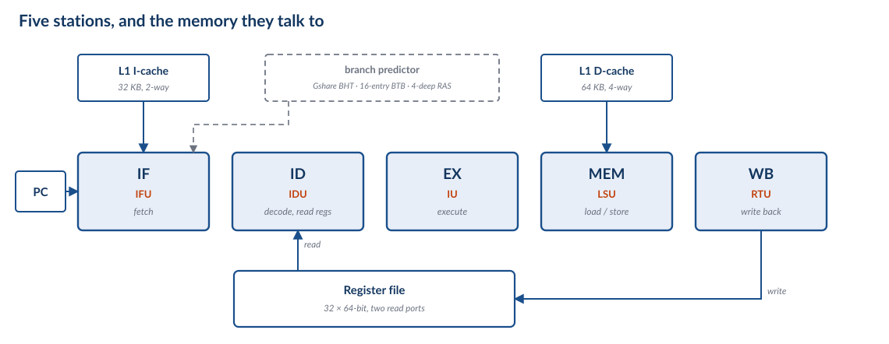
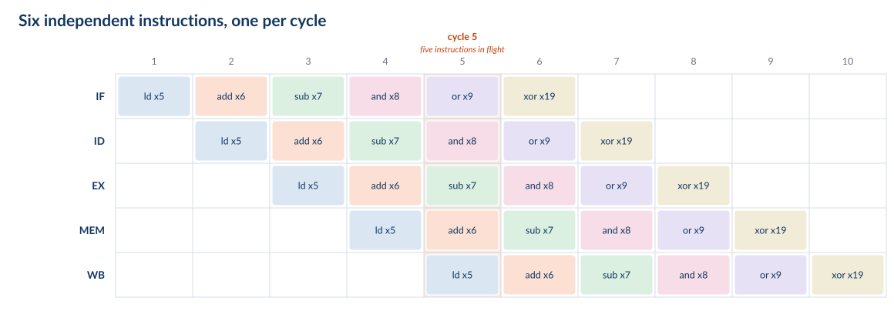

## Roadmap {.smaller}

The machine is the one in the chip: five stations, in order, one instruction per
cycle. The questions are the ones you would ask of any such machine.

1. **The five-stage machine** — what the stations are, and what the registers
   between them must hold
2. **Data hazards** — the register file hands back a stale value; stall, bypass,
   or speculate
3. **Control hazards** — NextPC is not known until the branch is decided
4. **Exceptions and interrupts** — implicit branches, and how to flush cleanly
5. **What the C906 really does** — and what changes when the pipeline gets deeper
6. **Synthesis** — CPI accounting, and quoted versus derived

::: {.notes}
Frame the deck: we are not going to build an invented teaching machine and then
compare it to the real one at the end. We are going to open the real one, strip it
to the five boxes that matter, and put the complications back one at a time.

That ordering is deliberate. Every hazard in Parts II–IV exists because of a
decision made in Part I, and every mechanism is a way of paying for it. If a
student can say *why* the stale-value problem exists, the three strategies are
almost forced.

Say up front what we are not doing: this is not the MIT 6.004 lecture. Their Beta
is the same shape — five stages, one memory, one register file — and the arc
(stall, bypass, speculate) is theirs, because it is the right arc. But we write
RISC-V, because that is the ISA in the chip, and we ground every mechanism in the
C906's manual rather than in a teaching ISA.
:::

# Part 0 — Framing

## The Machine in the Chip {.smaller}

{height=430px}

::: {.fragment}
> **Two caches, not one.** IF and MEM each have their own L1, so they never contend
> for a port. The textbook machine has a single memory and a *structural* hazard;
> ours cannot have one. That is an architectural decision, paid for in silicon.
:::

::: {.notes}
This is the deck's real starting point: not a hypothetical machine, but ours, with
the detail removed. The station names are ours; the unit names in orange are the
manual's (§2.2 of the C906 user manual, and its 图 2.1 microarchitecture figure,
which we redraw in Part V with every box we skipped).

Spend real time on the two-cache point, because it is the one non-obvious design
choice in the picture. A single-cycle or naive pipelined machine has one memory
port. In a pipeline, the fetch station wants it in IF and the load/store station
wants it in MEM — in the same cycle, for different instructions. That is a
*structural hazard*: not a data problem, not a control problem, just two stations
fighting over one piece of hardware. The classic fixes are to duplicate the memory,
to split the cache into instruction and data halves, or to stall every other cycle.
The C906 takes the second option: 32 KB instruction cache, 64 KB data cache,
separate ports. The structural hazard is simply gone, and it is why this deck can
spend all its time on the other two kinds.

Do not let them think it is free. Two caches means a store to code does not
automatically update the instruction stream, which is exactly why RISC-V has
`fence.i` — the architecture hands the coherence obligation back to software. A
structural hazard traded for a software rule. That trade is the interesting part,
not the cache sizes.

The dashed branch predictor is there to be pointed at and postponed: "that box is
the answer to Part III, and we will not open it yet."
:::

## One Instruction Per Clock {.smaller}

The datapath you just saw is *the* datapath. The only question is whether there is
a register between the stations.

With no registers we have the **single-cycle** machine: one clock has to cover all
five stations, so every instruction pays for the whole datapath.

$$t_{CLK} = t_{IF} + t_{RF} + t_{ALU} + t_{MEM} + t_{WB}$$

Put a register at each cut and it becomes the **pipelined** machine: the clock only
has to cover the slowest piece — the largest of the five, plus the register and
skew overhead.

$$t_{CLK} = \big(\text{slowest stage}\big) + t_{skew}$$

<!-- NOTE: do not write \max(...) here. MathJax 2.7.9 under Quarto/reveal silently
     truncates the expression at \max, leaving "t_CLK = max" on the slide. Verified
     against a standalone MathJax page, where the same TeX renders correctly, so it
     is this pipeline, not the TeX. Keep the operator out of the equations. -->

| | Single cycle | Pipelined |
|---|---|---|
| Clock period | sum of five stages | **slowest** of five stages |
| CPI | 1 | ≈ 1 |
| Instructions in flight | 1 | 5 |
| Speed | 1× | **≈ 4×** |

**It does not make an instruction faster. It makes the machine faster**, by having
five different instructions in it at once.

::: {.notes}
The framing to give them, because they have just looked at the diagram: this is the
same datapath. Pipelining did not add a functional unit or a memory; it added
registers. Everything else on this slide is arithmetic about what those registers
buy.

Point at the four arrows between the stations on the previous slide: those arrows
*are* the cuts. Every mechanism in the rest of the deck — the pipeline registers,
the stall, the bypass, the flush — is drawn at one of those four arrows, so it is
worth making them the landmark now.

Start with the honest version of the win. If the five stages were exactly equal,
the clock would fall by 5×. They are not equal, and the pipeline registers are not
free: each one costs setup, hold, and clock-to-output, and the clock has to cover
the *slowest* stage plus skew. A real five-stage in-order core gets roughly 4×,
not 5×. Say "about 4×" and mean it.

Note what has *not* changed: the same datapath, the same instruction set, the same
number of instructions executed. Pipelining is not an optimisation of the program.
It is a change in how the machine spends its time.

Foreshadow the cost, without spoiling it: the reason this is not a twenty-minute
lecture is that instructions are no longer alone in the machine. When one
instruction needs a value that another instruction has not finished computing yet,
something has to give. That is Part II.

The laundry analogy is fine if you keep it short: one washer, one dryer, one
folder, and five loads. You do not finish load 1 five times faster; you finish
five loads in the time of one plus the pipeline depth.
:::

## What We Are Leaving Out {.smaller}

| We keep | We ignore, for now |
|---|---|
| five stations, strictly in order | the FPU and VPU — separately pipelined, multi-cycle |
| one instruction issued per cycle | two-instruction fetch (the IFU fetches 2, issues 1) |
| 4-byte instructions, PC ← PC + 4 | compressed (2-byte) instructions |
| 32 registers, `x0` hardwired to zero | the MMU and TLB — assume no translation miss |
| separate L1 instruction and data caches | the AXI bus and everything behind it |
| branch prediction exists | *how* it predicts — that is Part III |

Abstraction is a promise about which complications we will not have. Every row on
the right is a real complication in a real core. We add them back one at a time.

::: {.notes}
This slide is the contract, and it is worth thirty seconds of explicit buy-in.
Nothing in Parts I–IV is a lie about our hardware; it is our hardware with
documented complications switched off, and we say which ones.

Two of these come back with teeth. A TLB miss is an exception, so it lands in Part
IV. And the two-instruction fetch is a hint that real cores are wider than they
issue: the C906 fetches two instructions per cycle and issues one, which is a
cheap way to keep the fetch stage ahead of the rest.

Compressed instructions are worth a sentence even though we drop them: with 2-byte
instructions, PC is not always PC+4, and the pipeline has to cope. We assume 4-byte
instructions so that "the next instruction" is unambiguous.
:::

# Part I — The Five-Stage Machine

## One Instruction, Five Stages {.smaller}

`ld x5, 8(x10)` — the one instruction that touches all five stations.

| Station | What happens | State touched |
|---|---|---|
| **IF** | fetch the word at PC; PC ← PC + 4 | I-cache, PC |
| **ID** | decode; read `x10`; immediate = 8 | register file (2 reads) |
| **EX** | address = `x10` + 8 | ALU |
| **MEM** | read the D-cache there | D-cache |
| **WB** | write into `x5` | register file (1 write) |

`rd` — the destination, `x5` — is read out of the instruction word in ID and carried
all the way to WB, because by then the instruction word itself is long gone.

Every instruction occupies all five stations, even where a station has nothing to
do: `add x6, x11, x12` walks through MEM and does nothing at all.

**Read the register file in ID, write it at the end of WB.** Everything in Parts
II–IV follows from that one sentence.

::: {.notes}
`ld` is the example because it is the only common instruction that needs every
station. Walk it left to right on the five-station figure from Part 0 — it is still
the same machine, and this is the first slide where we look inside a station.

The "all five stations" point is the one students get wrong on exams. An `add`
does not skip MEM; it occupies MEM for a cycle and the station does nothing. The
slot still has to be advanced, and if we need to cancel the instruction we have to
cancel it *in that slot*. That matters in Part III when we annul an instruction,
and in Part IV when we flush.

The register-file rule is the load-bearing sentence of the whole deck. Read in ID,
written at the end of WB. An instruction's result therefore does not exist in the
register file until three stages after the instruction that reads it has already
read. Everything else is bookkeeping.

Mention the two read ports and one write port now, because Part II's bypass
diagram depends on knowing that ID can read two registers at once but WB can only
write one.
:::

## The Only New State {.smaller}

{height=220px}

| Register | Must carry |
|---|---|
| **IF/ID** | instruction word, PC + 4 |
| **ID/EX** | A, B, immediate, `rs1`, `rs2`, `rd`, control |
| **EX/MEM** | ALU result Y, B (store data), `rd`, control |
| **MEM/WB** | memory data RD, ALU result Y, `rd`, control |

The datapath is the single-cycle datapath. Four registers, each holding exactly
what the next station needs to know.

::: {.notes}
This is the slide where the machine becomes understandable: we added four
registers and nothing else. No new functional units, no new memories, no new ALU.

Two things to draw out. First, the registers carry *control* as well as data —
that is the next slide. Second, they carry `rd`, because WB has to know where to
write and the instruction word itself is long gone by then.

The state point is the setup for Part II. An instruction's result now lives in a
pipeline register — EX/MEM, then MEM/WB — for two cycles before it reaches the
register file. During those two cycles the value exists, is correct, and is
invisible to any instruction that reads the register file. That is a data hazard,
stated as a fact about state rather than as a surprise.

Rough width, if asked: instruction word 32 bits, two register values 128, the
immediate 64, `rd` 5, plus a dozen control bits. Order of 250 bits per register,
and the clock has to move all of it every cycle. This is why pipeline registers
cost what they cost.
:::

## Five Instructions at Once {.smaller}

{height=390px}

- Six instructions, ten cycles: `CPI = 10/6 = 1.67`
- In general, *n* instructions through *k* stations: `n + k − 1` cycles, so
  `CPI = 1 + (k−1)/n`
- The `+4` is fill and drain — the first overhead, and the smallest

::: {.notes}
Count the table with them. Six instructions issue in six cycles; the last one
finishes in cycle 10. So CPI is 1.67, not 1.00.

Generalise: for n instructions and k stations, the total is n + k − 1 cycles, so
CPI = 1 + (k−1)/n. With n = 10⁹ and k = 5, the fill and drain is five cycles out
of a billion and is invisible. This is the number the marketing department quotes.

The honest point: this is the *clean* machine. No instruction here depends on any
other — look at the register numbers, they are all different — and there are no
branches. Every mechanism in Parts II–IV exists because real programs violate both
of those conditions, and every mechanism makes CPI worse than 1 + (k−1)/n. The
rest of the deck is the arithmetic of how much worse.
:::

## Control Travels With the Instruction {.smaller}

In the single-cycle machine, control is a function of the instruction word sitting
at the decoder. In the pipeline the word moves, so the control moves with it.

| Signal | Decided in | Used in |
|---|---|---|
| `RegWrite` | ID | WB |
| `MemRead`, `MemWrite` | ID | MEM |
| `MemToReg` | ID | WB |
| `ALUSrc`, `ALUOp` | ID | EX |
| `Branch`, `PCSrc` | ID | IF, next cycle |

Decode **once**, carry the bits down the pipeline in the ID/EX, EX/MEM and MEM/WB
registers. The alternative is five decoders and five copies of the opcode logic.

::: {.fragment}
`PCSrc` is the odd one out. It is decided in ID, but it does not act on the
instruction in ID — it changes what the *fetch* station does next. A control signal
that reaches backwards in time is how a control hazard happens.
:::

::: {.notes}
The single-cycle machine has one decoder and it produces signals that are used
immediately. In the pipeline the instruction spends five cycles in the machine, so
the signals have to survive the journey — hence the control bits in every pipeline
register on the previous slide.

The design principle: one decoder, five users. Decode in ID, then the control
travels. This is why 图 2.1 shows the IDU with arrows fanning out to everything:
it is the one place where the instruction is interpreted.

`PCSrc` is the odd one out, and flag it as such. It is decided in ID but it does
not act on the instruction in ID — it acts on the *fetch* station, changing what
gets fetched next. Control signals that reach backwards in time are exactly how
control hazards happen. Part III.

If someone asks about `rd` versus `rs`: `rs1` and `rs2` are needed in ID (to read)
and in EX (to compare against a forwarded value); `rd` is needed in WB. That is why
both are carried.
:::

## The Pipeline Diagram {.smaller}

<table class="pipe-tbl">
<thead>
<tr><th></th><th>1</th><th>2</th><th>3</th><th>4</th><th>5</th><th>6</th><th>7</th><th>8</th><th>9</th><th>10</th></tr>
</thead>
<tbody>
<tr><td>IF</td><td class="c1">ld x5</td><td class="c2">add x6</td><td class="c3">sub x7</td><td class="c4">and x8</td><td class="c5">or x9</td><td class="c6">xor x19</td><td></td><td></td><td></td><td></td></tr>
<tr><td>ID</td><td></td><td class="c1">ld x5</td><td class="c2">add x6</td><td class="c3">sub x7</td><td class="c4">and x8</td><td class="c5">or x9</td><td class="c6">xor x19</td><td></td><td></td><td></td></tr>
<tr><td>EX</td><td></td><td></td><td class="c1">ld x5</td><td class="c2">add x6</td><td class="c3">sub x7</td><td class="c4">and x8</td><td class="c5">or x9</td><td class="c6">xor x19</td><td></td><td></td></tr>
<tr><td>MEM</td><td></td><td></td><td></td><td class="c1">ld x5</td><td class="c2">add x6</td><td class="c3">sub x7</td><td class="c4">and x8</td><td class="c5">or x9</td><td class="c6">xor x19</td><td></td></tr>
<tr><td>WB</td><td></td><td></td><td></td><td></td><td class="c1">ld x5</td><td class="c2">add x6</td><td class="c3">sub x7</td><td class="c4">and x8</td><td class="c5">or x9</td><td class="c6">xor x19</td></tr>
</tbody>
</table>

::: {.fragment}
- **Read in ID, write at the end of WB.** `ld x5` reads `x10` in cycle 2 and writes
  `x5` at the end of cycle 5.
- An empty cell is a station doing nothing. A *hole* in a row is a **bubble** —
  the instruction waited a cycle.
- Every mechanism in Parts II–IV is drawn on one of these tables. The next one has
  two instructions that share a register.
:::

::: {.notes}
This is the deck's working tool. Everything in Parts II–IV is drawn on a table
shaped like this one, and the exam asks them to draw it.

How to read it: each row is a station, each column is a cycle, and each diagonal
band is one instruction walking down the machine. Colours are per instruction and
stay the same for the rest of the deck.

Count CPI from it: cycles along the bottom row, divided by instructions. Here 10/6.

The two rules to write on the board:

1. The register file is read in ID and written at the end of WB. So `ld x5` reads
   its source in cycle 2 and its destination becomes visible only at the end of
   cycle 5 — three cycles later.
2. An empty cell is a station idling, which is normal. A hole *in the middle of an
   instruction's band* is a bubble, which is not normal: it means we made the
   instruction wait, and it is what stalls and annulments look like.

Next slide in Part II draws the same table with two instructions that share a
register, and the table will show the problem before we say a word about it.
:::
