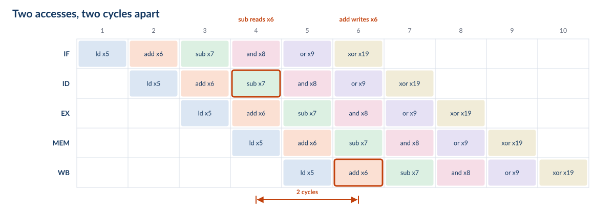
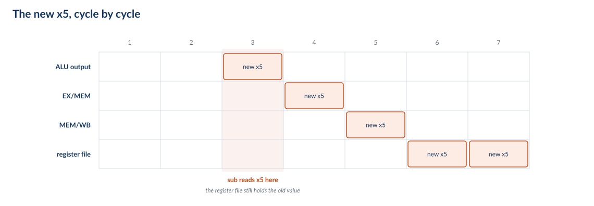

## Roadmap {.smaller}

The machine is the one in the chip: five stations, in order, one instruction per
cycle. The questions are the ones you would ask of any such machine.

1. **The five-stage machine** — what the stations are, and what the registers
   between them must hold
2. **Data hazards** — the register file hands back a stale value; stall, bypass,
   or speculate
3. **Control hazards** — NextPC is not known until the branch is decided
4. **Exceptions and interrupts** — implicit branches, and how to flush cleanly
5. **What the C906 really does** — and what changes when the pipeline gets deeper
6. **Synthesis** — CPI accounting, and quoted versus derived

::: {.notes}
Frame the deck: we are not going to build an invented teaching machine and then
compare it to the real one at the end. We are going to open the real one, strip it
to the five boxes that matter, and put the complications back one at a time.

That ordering is deliberate. Every hazard in Parts II–IV exists because of a
decision made in Part I, and every mechanism is a way of paying for it. If a
student can say *why* the stale-value problem exists, the three strategies are
almost forced.

Say up front what we are not doing: this is not the MIT 6.004 lecture. Their Beta
is the same shape — five stages, one memory, one register file — and the arc
(stall, bypass, speculate) is theirs, because it is the right arc. But we write
RISC-V, because that is the ISA in the chip, and we ground every mechanism in the
C906's manual rather than in a teaching ISA.
:::

# Part 0 — Framing

## The Machine in the Chip {.smaller}

{height=430px}

::: {.fragment}
> **Two caches, not one.** IF and MEM each have their own L1, so they never contend
> for a port. The textbook machine has a single memory and a *structural* hazard;
> ours cannot have one. That is an architectural decision, paid for in silicon.
:::

::: {.notes}
This is the deck's real starting point: not a hypothetical machine, but ours, with
the detail removed. The station names are ours; the unit names in orange are the
manual's (§2.2 of the C906 user manual, and its 图 2.1 microarchitecture figure,
which we redraw in Part V with every box we skipped).

Spend real time on the two-cache point, because it is the one non-obvious design
choice in the picture. A single-cycle or naive pipelined machine has one memory
port. In a pipeline, the fetch station wants it in IF and the load/store station
wants it in MEM — in the same cycle, for different instructions. That is a
*structural hazard*: not a data problem, not a control problem, just two stations
fighting over one piece of hardware. The classic fixes are to duplicate the memory,
to split the cache into instruction and data halves, or to stall every other cycle.
The C906 takes the second option: 32 KB instruction cache, 64 KB data cache,
separate ports. The structural hazard is simply gone, and it is why this deck can
spend all its time on the other two kinds.

Do not let them think it is free. Two caches means a store to code does not
automatically update the instruction stream, which is exactly why RISC-V has
`fence.i` — the architecture hands the coherence obligation back to software. A
structural hazard traded for a software rule. That trade is the interesting part,
not the cache sizes.

The dashed branch predictor is there to be pointed at and postponed: "that box is
the answer to Part III, and we will not open it yet."
:::

## One Instruction Per Clock {.smaller}

The datapath you just saw is *the* datapath. The only question is whether there is
a register between the stations.

With no registers we have the **single-cycle** machine: one clock has to cover all
five stations, so every instruction pays for the whole datapath.

$$t_{CLK} = t_{IF} + t_{RF} + t_{ALU} + t_{MEM} + t_{WB}$$

Put a register at each cut and it becomes the **pipelined** machine: the clock only
has to cover the slowest piece — the largest of the five, plus the register and
skew overhead.

$$t_{CLK} = \big(\text{slowest stage}\big) + t_{skew}$$

<!-- NOTE: do not write \max(...) here. MathJax 2.7.9 under Quarto/reveal silently
     truncates the expression at \max, leaving "t_CLK = max" on the slide. Verified
     against a standalone MathJax page, where the same TeX renders correctly, so it
     is this pipeline, not the TeX. Keep the operator out of the equations. -->

| | Single cycle | Pipelined |
|---|---|---|
| Clock period | sum of five stages | **slowest** of five stages |
| CPI | 1 | ≈ 1 |
| Instructions in flight | 1 | 5 |
| Speed | 1× | **≈ 4×** |

**It does not make an instruction faster. It makes the machine faster**, by having
five different instructions in it at once.

::: {.notes}
The framing to give them, because they have just looked at the diagram: this is the
same datapath. Pipelining did not add a functional unit or a memory; it added
registers. Everything else on this slide is arithmetic about what those registers
buy.

Point at the four arrows between the stations on the previous slide: those arrows
*are* the cuts. Every mechanism in the rest of the deck — the pipeline registers,
the stall, the bypass, the flush — is drawn at one of those four arrows, so it is
worth making them the landmark now.

Start with the honest version of the win. If the five stages were exactly equal,
the clock would fall by 5×. They are not equal, and the pipeline registers are not
free: each one costs setup, hold, and clock-to-output, and the clock has to cover
the *slowest* stage plus skew. A real five-stage in-order core gets roughly 4×,
not 5×. Say "about 4×" and mean it.

Note what has *not* changed: the same datapath, the same instruction set, the same
number of instructions executed. Pipelining is not an optimisation of the program.
It is a change in how the machine spends its time.

Foreshadow the cost, without spoiling it: the reason this is not a twenty-minute
lecture is that instructions are no longer alone in the machine. When one
instruction needs a value that another instruction has not finished computing yet,
something has to give. That is Part II.

The laundry analogy is fine if you keep it short: one washer, one dryer, one
folder, and five loads. You do not finish load 1 five times faster; you finish
five loads in the time of one plus the pipeline depth.
:::

## What We Are Leaving Out {.smaller}

| We keep | We ignore, for now |
|---|---|
| five stations, strictly in order | the FPU and VPU — separately pipelined, multi-cycle |
| one instruction issued per cycle | two-instruction fetch (the IFU fetches 2, issues 1) |
| 4-byte instructions, PC ← PC + 4 | compressed (2-byte) instructions |
| 32 registers, `x0` hardwired to zero | the MMU and TLB — assume no translation miss |
| separate L1 instruction and data caches | the AXI bus and everything behind it |
| branch prediction exists | *how* it predicts — that is Part III |

Abstraction is a promise about which complications we will not have. Every row on
the right is a real complication in a real core. We add them back one at a time.

::: {.notes}
This slide is the contract, and it is worth thirty seconds of explicit buy-in.
Nothing in Parts I–IV is a lie about our hardware; it is our hardware with
documented complications switched off, and we say which ones.

Two of these come back with teeth. A TLB miss is an exception, so it lands in Part
IV. And the two-instruction fetch is a hint that real cores are wider than they
issue: the C906 fetches two instructions per cycle and issues one, which is a
cheap way to keep the fetch stage ahead of the rest.

Compressed instructions are worth a sentence even though we drop them: with 2-byte
instructions, PC is not always PC+4, and the pipeline has to cope. We assume 4-byte
instructions so that "the next instruction" is unambiguous.
:::

# Part I — The Five-Stage Machine

## One Instruction, Five Stages {.smaller}

`ld x5, 8(x10)` — the one instruction that touches all five stations.

| Station | What happens | State touched |
|---|---|---|
| **IF** | fetch the word at PC; PC ← PC + 4 | I-cache, PC |
| **ID** | decode; read `x10`; immediate = 8 | register file (2 reads) |
| **EX** | address = `x10` + 8 | ALU |
| **MEM** | read the D-cache there | D-cache |
| **WB** | write into `x5` | register file (1 write) |

`rd` — the destination, `x5` — is read out of the instruction word in ID and carried
all the way to WB, because by then the instruction word itself is long gone.

Every instruction occupies all five stations, even where a station has nothing to
do: `add x6, x11, x12` walks through MEM and does nothing at all.

**Read the register file in ID, write it at the end of WB.** Everything in Parts
II–IV follows from that one sentence.

::: {.notes}
`ld` is the example because it is the only common instruction that needs every
station. Walk it left to right on the five-station figure from Part 0 — it is still
the same machine, and this is the first slide where we look inside a station.

The "all five stations" point is the one students get wrong on exams. An `add`
does not skip MEM; it occupies MEM for a cycle and the station does nothing. The
slot still has to be advanced, and if we need to cancel the instruction we have to
cancel it *in that slot*. That matters in Part III when we annul an instruction,
and in Part IV when we flush.

The register-file rule is the load-bearing sentence of the whole deck. Read in ID,
written at the end of WB. An instruction's result therefore does not exist in the
register file until three stages after the instruction that reads it has already
read. Everything else is bookkeeping.

Mention the two read ports and one write port now, because Part II's bypass
diagram depends on knowing that ID can read two registers at once but WB can only
write one.
:::

## The Only New State {.smaller}

{height=220px}

| Register | Must carry |
|---|---|
| **IF/ID** | instruction word, PC + 4 |
| **ID/EX** | A, B, immediate, `rs1`, `rs2`, `rd`, control |
| **EX/MEM** | ALU result Y, B (store data), `rd`, control |
| **MEM/WB** | memory data RD, ALU result Y, `rd`, control |

The datapath is the single-cycle datapath. Four registers, each holding exactly
what the next station needs to know.

::: {.notes}
This is the slide where the machine becomes understandable: we added four
registers and nothing else. No new functional units, no new memories, no new ALU.

Two things to draw out. First, the registers carry *control* as well as data: the
instruction is decoded once, in ID, and the control bits ride down inside ID/EX,
EX/MEM and MEM/WB to the station that uses them. The alternative is five decoders
and five copies of the opcode logic, so one decoder with five users is the design.
Second, they carry `rd`, because WB has to know where to write and the instruction
word itself is long gone by then.

The state point is the setup for Part II. An instruction's result now lives in a
pipeline register — EX/MEM, then MEM/WB — for two cycles before it reaches the
register file. During those two cycles the value exists, is correct, and is
invisible to any instruction that reads the register file. That is a data hazard,
stated as a fact about state rather than as a surprise.

Rough width, if asked: instruction word 32 bits, two register values 128, the
immediate 64, `rd` 5, plus a dozen control bits. Order of 250 bits per register,
and the clock has to move all of it every cycle. This is why pipeline registers
cost what they cost.
:::

## Five Instructions at Once {.smaller}

{height=390px}

- Six instructions, ten cycles: `CPI = 10/6 = 1.67`
- In general, *n* instructions through *k* stations: `n + k − 1` cycles, so
  `CPI = 1 + (k−1)/n`
- The `+4` is fill and drain — the first overhead, and the smallest

::: {.notes}
Count the table with them. Six instructions issue in six cycles; the last one
finishes in cycle 10. So CPI is 1.67, not 1.00.

Generalise: for n instructions and k stations, the total is n + k − 1 cycles, so
CPI = 1 + (k−1)/n. With n = 10⁹ and k = 5, the fill and drain is five cycles out
of a billion and is invisible. This is the number the marketing department quotes.

The honest point: this is the *clean* machine. No instruction here depends on any
other — look at the register numbers, they are all different — and there are no
branches. Every mechanism in Parts II–IV exists because real programs violate both
of those conditions, and every mechanism makes CPI worse than 1 + (k−1)/n. The
rest of the deck is the arithmetic of how much worse.
:::

# Part II — Data Hazards

Six instructions with six different destinations ran at one per clock. Change one
register number.

## The Program {.smaller}

```asm
ld   x5, 8(x10)
add  x6, x11, x12      # writes x6
sub  x7, x6, x14       # reads  x6     <-- the one register changed
and  x8, x15, x16
or   x9, x17, x18
xor  x19, x20, x21
```

The six instructions from the last slide, with **one register changed**: `sub` used
to read `x13`, and now takes its first source from `add`'s destination.

::: {.fragment}
The program is legal, and the machine will not complain.
:::

::: {.fragment}
So: which cycle does `sub` read `x6`, and which cycle does `add` write it?
:::

::: {.notes}
This slide exists because the pipeline table only ever shows *destinations*. Without
the source operands on screen, "sub x7" and "add x6" look like they have nothing to
do with each other, and the hazard on the next slide looks like magic. So: show the
program, and mark the two operands that matter.

The continuity is deliberate — this is the same six instructions as the last slide
of Part I, not a new example. One token changed: `sub`'s first source, `x13` → `x6`.
Everything else is identical, including the register numbers of every destination.
That is the point of the divider's line: the machine did not change, the program
barely changed.

Two facts to get them to say out loud:

- `add x6, x11, x12` **writes** `x6`.
- `sub x7, x6, x14` **reads** `x6`.

Nothing else in the program touches `x6`. So there is exactly one dependency here,
and it is between two *adjacent* instructions — which is the most common case in
real code and the one the hardware has to make fast.

Worth asking before you move on, because it is the active-learning moment of the
part: "which cycle does `sub` read `x6` in? Which cycle does `add` write it in?"
They can answer both from the table they saw two slides ago, and the next slide
confirms it. Do not answer it for them.

And say the legal point plainly: the ISA specifies what the program means, not when
each step happens. This program has one obvious meaning, and the hardware is
required to produce it. Nothing in the encoding says "wait for the `add`".
:::

## One Register, Two Instructions {.smaller}

{height=380px}

`sub` reads `x6` in cycle 4. `add` does not write `x6` until the end of cycle 6.

::: {.fragment}
So `sub` reads whatever `x6` held *before* the `add`. The machine has not slowed
down — it has computed the wrong answer, at full speed.
:::

::: {.notes}
Put the two tables side by side in your head: the six instructions from Part I, and
these six. One source register changed. `sub` now takes its first source from
`add`'s destination.

Walk the arithmetic on the table, because this is the moment students either get
it or spend the rest of the term guessing:

- `add` is IF 2, ID 3, EX 4, MEM 5, WB 6. It writes `x6` at the **end** of cycle 6.
- `sub` is IF 3, ID 4, EX 5. It reads `x6` in **cycle 4**.

Now the sentence to land: `sub`'s read and `add`'s execute are in the *same cycle*.
The value is being computed at the same moment it is being read. The register file
is not where the answer is, so `sub` gets the previous value — the one from before
the `add` ever ran.

Two things worth saying explicitly:

1. Nothing goes wrong in any visible sense. No trap, no error, no slow-down. The
   machine happily computes the wrong answer at full speed. That is what makes this
   a *hazard* rather than an exception: a hazard is a design problem, an exception
   is an architectural event. Part IV is about the other one.
2. The hazard is created by the pipeline, not by the program or the ISA. The same
   six instructions on the single-cycle machine are correct, because there the
   write happens before the next read can start. Depth is what breaks it.

If someone asks "why not just write the register file earlier?" — that is a good
question with a good answer. The value does not exist until the end of EX, and for
a load it does not exist until the end of MEM. You cannot move the write earlier
than the data. You have to move the *data* — which is the next slide.
:::

## Where the Value Is {.smaller}

{height=360px}

The value is not missing. It is in a pipeline register, one station ahead of where
`sub` is looking. **A result exists in the machine for two cycles before it exists
in the register file.**

::: {.fragment}
Three ways to fix that, and every processor uses some combination:

- **stall** — make `sub` wait until the value reaches the register file
- **bypass** — hand `sub` the value from the pipeline register, as soon as it exists
- **speculate** — guess the value, and check later
:::

::: {.notes}
This is the reframing that makes the rest of Part II mechanical. The value is not
lost and it is not late; it is *in the wrong place*. Follow it across the figure:
the ALU produces it at the end of cycle 4, EX/MEM holds it during cycle 5, MEM/WB
holds it during cycle 6, and only then does the register file have it. `sub` looked
in cycle 4, when the register file still held the old one.

So there are exactly three things you can do, and they are the three on the slide:

- **Stall** — the value is where it needs to be eventually, so wait for it. Costs
  cycles. Simple to reason about, expensive in CPI.
- **Bypass** (also called forwarding) — the value exists in EX/MEM, so wire it
  round to the ALU input and use it now. Costs wires and a mux; costs no cycles.
- **Speculate** — guess what the value will be, keep going, and check when the real
  one arrives. Costs nothing when the guess is right and a flush when it is wrong.

Be honest that value speculation is rare in practice: it shows up for things like
predictable load values, not as a general answer to data hazards. It is on the
slide because it is the third member of the family, and because it is the *main*
answer to control hazards in Part III — where the thing being guessed is the next
PC, not a register value.

Then say what our core does, because it saves a slide later: the C906 forwards
operands in the integer unit — the manual says single-cycle ALU instructions have
no data-hazard stall — so the ALU-to-ALU case above is free. The case forwarding
cannot fix is load-to-use, and that is where the stall comes back. Both mechanisms
are in the core; neither is hypothetical.

Last framing for the part: every slide from here is one of these three, priced.
Stall buys correctness with CPI, bypass buys it with silicon, speculation buys it
with a gamble. There is no fourth option.
:::
