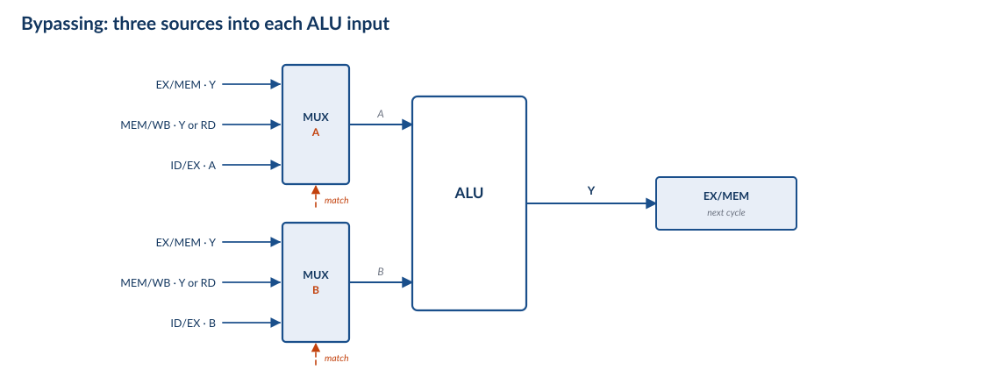
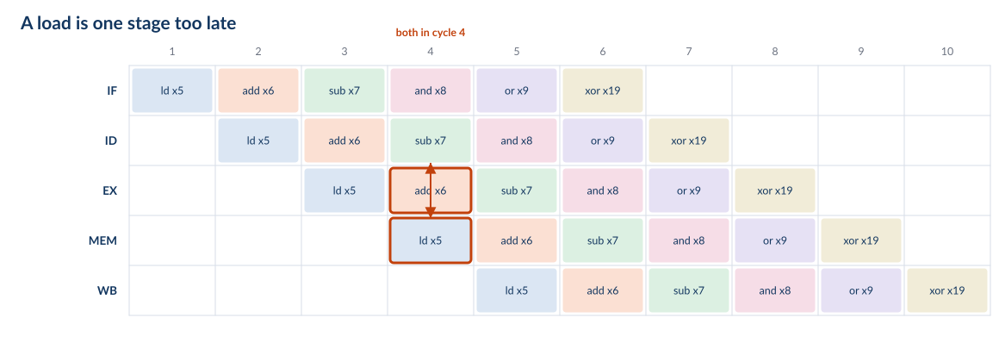
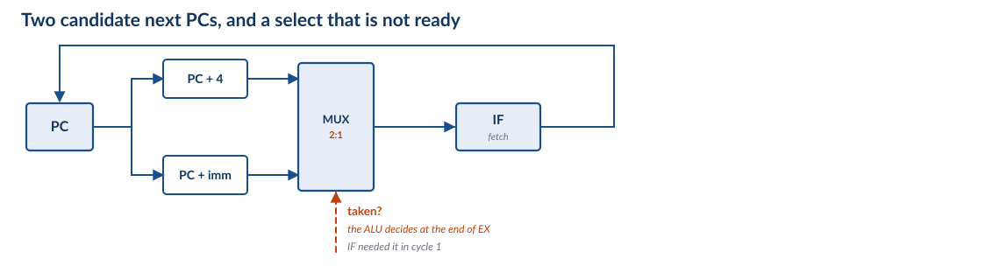
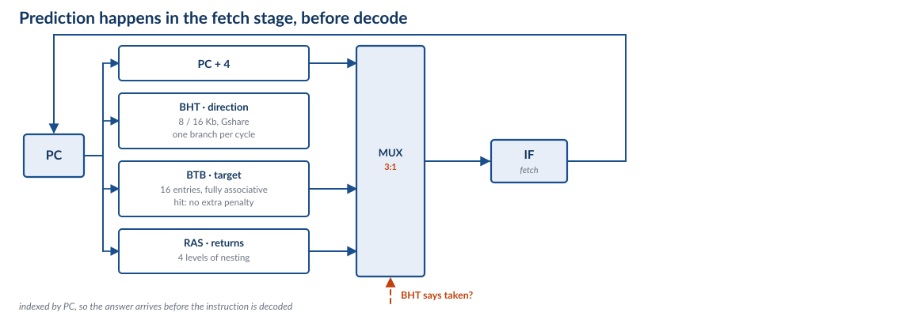
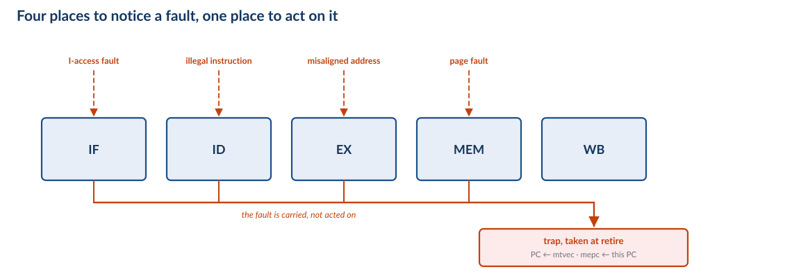

## Roadmap {.smaller}

The machine is the one in the chip: five stations, in order, one instruction per
cycle. The questions are the ones you would ask of any such machine.

1. **The five-stage machine** — what the stations are, and what the registers
   between them must hold
2. **Data hazards** — the register file hands back a stale value; stall, bypass,
   or speculate
3. **Control hazards** — NextPC is not known until the branch is decided
4. **Exceptions and interrupts** — control transfers you cannot predict, and why
   the machine waits until retire to take them
5. **What the C906 really does** — and what changes when the pipeline gets deeper
6. **Synthesis** — CPI accounting, and quoted versus derived

::: {.notes}
Frame the deck: we are not going to build an invented teaching machine and then
compare it to the real one at the end. We are going to open the real one, strip it
to the five boxes that matter, and put the complications back one at a time.

That ordering is deliberate. Every hazard in Parts II–IV exists because of a
decision made in Part I, and every mechanism is a way of paying for it. If a
student can say *why* the stale-value problem exists, the three strategies are
almost forced.

Say up front what we are not doing: this is not the MIT 6.004 lecture. Their Beta
is the same shape — five stages, one memory, one register file — and the arc
(stall, bypass, speculate) is theirs, because it is the right arc. But we write
RISC-V, because that is the ISA in the chip, and we ground every mechanism in the
C906's manual rather than in a teaching ISA.
:::

# Part 0 — Framing

## The Machine in the Chip {.smaller}

{height=430px}

::: {.fragment}
> **Two caches, not one.** IF and MEM each have their own L1, so they never contend
> for a port. The textbook machine has a single memory and a *structural* hazard;
> ours cannot have one. That is an architectural decision, paid for in silicon.
:::

::: {.notes}
This is the deck's real starting point: not a hypothetical machine, but ours, with
the detail removed. The station names are ours; the unit names in orange are the
manual's (§2.2 of the C906 user manual, and its 图 2.1 microarchitecture figure,
which we redraw in Part V with every box we skipped).

Spend real time on the two-cache point, because it is the one non-obvious design
choice in the picture. A single-cycle or naive pipelined machine has one memory
port. In a pipeline, the fetch station wants it in IF and the load/store station
wants it in MEM — in the same cycle, for different instructions. That is a
*structural hazard*: not a data problem, not a control problem, just two stations
fighting over one piece of hardware. The classic fixes are to duplicate the memory,
to split the cache into instruction and data halves, or to stall every other cycle.
The C906 takes the second option: 32 KB instruction cache, 64 KB data cache,
separate ports. The structural hazard is simply gone, and it is why this deck can
spend all its time on the other two kinds.

Do not let them think it is free. Two caches means a store to code does not
automatically update the instruction stream, which is exactly why RISC-V has
`fence.i` — the architecture hands the coherence obligation back to software. A
structural hazard traded for a software rule. That trade is the interesting part,
not the cache sizes.

The dashed branch predictor is there to be pointed at and postponed: "that box is
the answer to Part III, and we will not open it yet."
:::

## One Instruction Per Clock {.smaller}

The datapath you just saw is *the* datapath. The only question is whether there is
a register between the stations.

With no registers we have the **single-cycle** machine: one clock has to cover all
five stations, so every instruction pays for the whole datapath.

$$t_{CLK} = t_{IF} + t_{RF} + t_{ALU} + t_{MEM} + t_{WB}$$

Put a register at each cut and it becomes the **pipelined** machine: the clock only
has to cover the slowest piece — the largest of the five, plus the register and
skew overhead.

$$t_{CLK} = \big(\text{slowest stage}\big) + t_{skew}$$

<!-- NOTE: do not write \max(...) here. MathJax 2.7.9 under Quarto/reveal silently
     truncates the expression at \max, leaving "t_CLK = max" on the slide. Verified
     against a standalone MathJax page, where the same TeX renders correctly, so it
     is this pipeline, not the TeX. Keep the operator out of the equations. -->

| | Single cycle | Pipelined |
|---|---|---|
| Clock period | sum of five stages | **slowest** of five stages |
| CPI | 1 | ≈ 1 |
| Instructions in flight | 1 | 5 |
| Speed | 1× | **≈ 4×** |

**It does not make an instruction faster. It makes the machine faster**, by having
five different instructions in it at once.

::: {.notes}
The framing to give them, because they have just looked at the diagram: this is the
same datapath. Pipelining did not add a functional unit or a memory; it added
registers. Everything else on this slide is arithmetic about what those registers
buy.

Point at the four arrows between the stations on the previous slide: those arrows
*are* the cuts. Every mechanism in the rest of the deck — the pipeline registers,
the stall, the bypass, the flush — is drawn at one of those four arrows, so it is
worth making them the landmark now.

Start with the honest version of the win. If the five stages were exactly equal,
the clock would fall by 5×. They are not equal, and the pipeline registers are not
free: each one costs setup, hold, and clock-to-output, and the clock has to cover
the *slowest* stage plus skew. A real five-stage in-order core gets roughly 4×,
not 5×. Say "about 4×" and mean it.

Note what has *not* changed: the same datapath, the same instruction set, the same
number of instructions executed. Pipelining is not an optimisation of the program.
It is a change in how the machine spends its time.

Foreshadow the cost, without spoiling it: the reason this is not a twenty-minute
lecture is that instructions are no longer alone in the machine. When one
instruction needs a value that another instruction has not finished computing yet,
something has to give. That is Part II.

The laundry analogy is fine if you keep it short: one washer, one dryer, one
folder, and five loads. You do not finish load 1 five times faster; you finish
five loads in the time of one plus the pipeline depth.
:::

## What We Are Leaving Out {.smaller}

| We keep | We ignore, for now |
|---|---|
| five stations, strictly in order | the FPU and VPU — separately pipelined, multi-cycle |
| one instruction issued per cycle | two-instruction fetch (the IFU fetches 2, issues 1) |
| 4-byte instructions, PC ← PC + 4 | compressed (2-byte) instructions |
| 32 registers, `x0` hardwired to zero | the MMU and TLB — assume no translation miss |
| separate L1 instruction and data caches | the AXI bus and everything behind it |
| branch prediction exists | *how* it predicts — that is Part III |

Abstraction is a promise about which complications we will not have. Every row on
the right is a real complication in a real core. We add them back one at a time.

::: {.notes}
This slide is the contract, and it is worth thirty seconds of explicit buy-in.
Nothing in Parts I–IV is a lie about our hardware; it is our hardware with
documented complications switched off, and we say which ones.

Two of these come back with teeth. A TLB miss is an exception, so it lands in Part
IV. And the two-instruction fetch is a hint that real cores are wider than they
issue: the C906 fetches two instructions per cycle and issues one, which is a
cheap way to keep the fetch stage ahead of the rest.

Compressed instructions are worth a sentence even though we drop them: with 2-byte
instructions, PC is not always PC+4, and the pipeline has to cope. We assume 4-byte
instructions so that "the next instruction" is unambiguous.
:::

# Part I — The Five-Stage Machine

## One Instruction, Five Stages {.smaller}

`ld x5, 8(x10)` — the one instruction that touches all five stations.

| Station | What happens | State touched |
|---|---|---|
| **IF** | fetch the word at PC; PC ← PC + 4 | I-cache, PC |
| **ID** | decode; read `x10`; immediate = 8 | register file (2 reads) |
| **EX** | address = `x10` + 8 | ALU |
| **MEM** | read the D-cache there | D-cache |
| **WB** | write into `x5` | register file (1 write) |

`rd` — the destination, `x5` — is read out of the instruction word in ID and carried
all the way to WB, because by then the instruction word itself is long gone.

Every instruction occupies all five stations, even where a station has nothing to
do: `add x6, x11, x12` walks through MEM and does nothing at all.

**Read the register file in ID, write it at the end of WB.** Everything in Parts
II–IV follows from that one sentence.

::: {.notes}
`ld` is the example because it is the only common instruction that needs every
station. Walk it left to right on the five-station figure from Part 0 — it is still
the same machine, and this is the first slide where we look inside a station.

The "all five stations" point is the one students get wrong on exams. An `add`
does not skip MEM; it occupies MEM for a cycle and the station does nothing. The
slot still has to be advanced, and if we need to cancel the instruction we have to
cancel it *in that slot*. That matters in Part III when we annul an instruction,
and in Part IV when we flush.

The register-file rule is the load-bearing sentence of the whole deck. Read in ID,
written at the end of WB. An instruction's result therefore does not exist in the
register file until three stages after the instruction that reads it has already
read. Everything else is bookkeeping.

Mention the two read ports and one write port now, because Part II's bypass
diagram depends on knowing that ID can read two registers at once but WB can only
write one.
:::

## The Only New State {.smaller}

{height=220px}

| Register | Must carry |
|---|---|
| **IF/ID** | instruction word, PC + 4 |
| **ID/EX** | A, B, immediate, `rs1`, `rs2`, `rd`, control |
| **EX/MEM** | ALU result Y, B (store data), `rd`, control |
| **MEM/WB** | memory data RD, ALU result Y, `rd`, control |

The datapath is the single-cycle datapath. Four registers, each holding exactly
what the next station needs to know.

::: {.notes}
This is the slide where the machine becomes understandable: we added four
registers and nothing else. No new functional units, no new memories, no new ALU.

Two things to draw out. First, the registers carry *control* as well as data: the
instruction is decoded once, in ID, and the control bits ride down inside ID/EX,
EX/MEM and MEM/WB to the station that uses them. The alternative is five decoders
and five copies of the opcode logic, so one decoder with five users is the design.
Second, they carry `rd`, because WB has to know where to write and the instruction
word itself is long gone by then.

The state point is the setup for Part II. An instruction's result now lives in a
pipeline register — EX/MEM, then MEM/WB — for two cycles before it reaches the
register file. During those two cycles the value exists, is correct, and is
invisible to any instruction that reads the register file. That is a data hazard,
stated as a fact about state rather than as a surprise.

Rough width, if asked: instruction word 32 bits, two register values 128, the
immediate 64, `rd` 5, plus a dozen control bits. Order of 250 bits per register,
and the clock has to move all of it every cycle. This is why pipeline registers
cost what they cost.
:::

## Five Instructions at Once {.smaller}

{height=390px}

- Six instructions, ten cycles: `CPI = 10/6 = 1.67`
- In general, *n* instructions through *k* stations: `n + k − 1` cycles, so
  `CPI = 1 + (k−1)/n`
- The `+4` is fill and drain — the first overhead, and the smallest

::: {.notes}
Count the table with them. Six instructions issue in six cycles; the last one
finishes in cycle 10. So CPI is 1.67, not 1.00.

Generalise: for n instructions and k stations, the total is n + k − 1 cycles, so
CPI = 1 + (k−1)/n. With n = 10⁹ and k = 5, the fill and drain is five cycles out
of a billion and is invisible. This is the number the marketing department quotes.

The honest point: this is the *clean* machine. No instruction here depends on any
other — look at the register numbers, they are all different — and there are no
branches. Every mechanism in Parts II–IV exists because real programs violate both
of those conditions, and every mechanism makes CPI worse than 1 + (k−1)/n. The
rest of the deck is the arithmetic of how much worse.
:::

# Part II — Data Hazards

Six instructions with six different destinations ran at one per clock. Change one
register number.

## The Program {.smaller}

```asm
ld   x5, 8(x10)
add  x6, x11, x12      # writes x6
sub  x7, x6, x14       # reads  x6     <-- the one register changed
and  x8, x15, x16
or   x9, x17, x18
xor  x19, x20, x21
```

The six instructions from the last slide, with **one register changed**: `sub` used
to read `x13`, and now takes its first source from `add`'s destination.

::: {.fragment}
The program is legal, and the machine will not complain.
:::

::: {.fragment}
So: which cycle does `sub` read `x6`, and which cycle does `add` write it?
:::

::: {.notes}
This slide exists because the pipeline table only ever shows *destinations*. Without
the source operands on screen, "sub x7" and "add x6" look like they have nothing to
do with each other, and the hazard on the next slide looks like magic. So: show the
program, and mark the two operands that matter.

The continuity is deliberate — this is the same six instructions as the last slide
of Part I, not a new example. One token changed: `sub`'s first source, `x13` → `x6`.
Everything else is identical, including the register numbers of every destination.
That is the point of the divider's line: the machine did not change, the program
barely changed.

Two facts to get them to say out loud:

- `add x6, x11, x12` **writes** `x6`.
- `sub x7, x6, x14` **reads** `x6`.

Nothing else in the program touches `x6`. So there is exactly one dependency here,
and it is between two *adjacent* instructions — which is the most common case in
real code and the one the hardware has to make fast.

Worth asking before you move on, because it is the active-learning moment of the
part: "which cycle does `sub` read `x6` in? Which cycle does `add` write it in?"
They can answer both from the table they saw two slides ago, and the next slide
confirms it. Do not answer it for them.

And say the legal point plainly: the ISA specifies what the program means, not when
each step happens. This program has one obvious meaning, and the hardware is
required to produce it. Nothing in the encoding says "wait for the `add`".
:::

## One Register, Two Instructions {.smaller}

{height=380px}

`sub` reads `x6` in cycle 4. `add` does not write `x6` until the end of cycle 6.

::: {.fragment}
So `sub` reads whatever `x6` held *before* the `add`. The machine has not slowed
down — it has computed the wrong answer, at full speed.
:::

::: {.notes}
Put the two tables side by side in your head: the six instructions from Part I, and
these six. One source register changed. `sub` now takes its first source from
`add`'s destination.

Walk the arithmetic on the table, because this is the moment students either get
it or spend the rest of the term guessing:

- `add` is IF 2, ID 3, EX 4, MEM 5, WB 6. It writes `x6` at the **end** of cycle 6.
- `sub` is IF 3, ID 4, EX 5. It reads `x6` in **cycle 4**.

Now the sentence to land: `sub`'s read and `add`'s execute are in the *same cycle*.
The value is being computed at the same moment it is being read. The register file
is not where the answer is, so `sub` gets the previous value — the one from before
the `add` ever ran.

Two things worth saying explicitly:

1. Nothing goes wrong in any visible sense. No trap, no error, no slow-down. The
   machine happily computes the wrong answer at full speed. That is what makes this
   a *hazard* rather than an exception: a hazard is a design problem, an exception
   is an architectural event. Part IV is about the other one.
2. The hazard is created by the pipeline, not by the program or the ISA. The same
   six instructions on the single-cycle machine are correct, because there the
   write happens before the next read can start. Depth is what breaks it.

If someone asks "why not just write the register file earlier?" — that is a good
question with a good answer. The value does not exist until the end of EX, and for
a load it does not exist until the end of MEM. You cannot move the write earlier
than the data. You have to move the *data* — which is the next slide.
:::

## Where the Value Is {.smaller}

{height=360px}

The value is not missing. It is in a pipeline register, one station ahead of where
`sub` is looking. **A result exists in the machine for two cycles before it exists
in the register file.**

::: {.fragment}
Three ways to fix that, and every processor uses some combination:

- **stall** — make `sub` wait until the value reaches the register file
- **bypass** — hand `sub` the value from the pipeline register, as soon as it exists
- **speculate** — guess the value, and check later
:::

::: {.notes}
This is the reframing that makes the rest of Part II mechanical. The value is not
lost and it is not late; it is *in the wrong place*. Follow it across the figure:
the ALU produces it at the end of cycle 4, EX/MEM holds it during cycle 5, MEM/WB
holds it during cycle 6, and only then does the register file have it. `sub` looked
in cycle 4, when the register file still held the old one.

So there are exactly three things you can do, and they are the three on the slide:

- **Stall** — the value is where it needs to be eventually, so wait for it. Costs
  cycles. Simple to reason about, expensive in CPI.
- **Bypass** (also called forwarding) — the value exists in EX/MEM, so wire it
  round to the ALU input and use it now. Costs wires and a mux; costs no cycles.
- **Speculate** — guess what the value will be, keep going, and check when the real
  one arrives. Costs nothing when the guess is right and a flush when it is wrong.

Be honest that value speculation is rare in practice: it shows up for things like
predictable load values, not as a general answer to data hazards. It is on the
slide because it is the third member of the family, and because it is the *main*
answer to control hazards in Part III — where the thing being guessed is the next
PC, not a register value.

Then say what our core does, because it saves a slide later: the C906 forwards
operands in the integer unit — the manual says single-cycle ALU instructions have
no data-hazard stall — so the ALU-to-ALU case above is free. The case forwarding
cannot fix is load-to-use, and that is where the stall comes back. Both mechanisms
are in the core; neither is hypothetical.

Last framing for the part: every slide from here is one of these three, priced.
Stall buys correctness with CPI, bypass buys it with silicon, speculation buys it
with a gamble. There is no fourth option.
:::

## Stall {.smaller}

<table class="pipe-tbl">
<thead>
<tr><th></th><th>1</th><th>2</th><th>3</th><th>4</th><th>5</th><th>6</th><th>7</th><th>8</th><th>9</th><th>10</th><th>11</th><th>12</th></tr>
</thead>
<tbody>
<tr><td>IF</td><td class="c1">ld x5</td><td class="c2">add x6</td><td class="c3">sub x7</td><td class="c4">and x8</td><td class="c4">and x8</td><td class="c4">and x8</td><td class="c5">or x9</td><td class="c6">xor x19</td><td></td><td></td><td></td><td></td></tr>
<tr><td>ID</td><td></td><td class="c1">ld x5</td><td class="c2">add x6</td><td class="c3 frozen">sub x7</td><td class="c3 frozen">sub x7</td><td class="c3 frozen">sub x7</td><td class="c4">and x8</td><td class="c5">or x9</td><td class="c6">xor x19</td><td></td><td></td><td></td></tr>
<tr><td>EX</td><td></td><td></td><td class="c1">ld x5</td><td class="c2">add x6</td><td class="nop">NOP</td><td class="nop">NOP</td><td class="c3">sub x7</td><td class="c4">and x8</td><td class="c5">or x9</td><td class="c6">xor x19</td><td></td><td></td></tr>
<tr><td>MEM</td><td></td><td></td><td></td><td class="c1">ld x5</td><td class="c2">add x6</td><td class="nop">NOP</td><td class="nop">NOP</td><td class="c3">sub x7</td><td class="c4">and x8</td><td class="c5">or x9</td><td class="c6">xor x19</td><td></td></tr>
<tr><td>WB</td><td></td><td></td><td></td><td></td><td class="c1">ld x5</td><td class="c2">add x6</td><td class="nop">NOP</td><td class="nop">NOP</td><td class="c3">sub x7</td><td class="c4">and x8</td><td class="c5">or x9</td><td class="c6">xor x19</td></tr>
</tbody>
</table>

`sub`'s ID stage is frozen for two cycles, and a NOP is injected into EX each time.
The bubbles then travel down the machine on their own.

::: {.fragment}
Six instructions now take **12 cycles instead of 10** — CPI 2.0 instead of 1.67.
:::

::: {.notes}
The fix that always works: do not let the instruction advance. `sub` stays in ID
until the value it needs is in the register file, and the rest of the machine keeps
running — what travels down instead of an instruction is a bubble.

Read the table with them, left to right, in the ID row: `sub` sits there in cycles
4, 5 and 6 (the dashed cells), which is two stalls. In cycles 5 and 6 there is a
NOP in EX, and those NOPs then move down the table on their own — by cycle 7 they
are in MEM, and by cycle 8 in WB. That is what a bubble is: an empty slot, not an
instruction that does nothing.

The cost is on the slide: ten cycles become twelve. Nothing is wrong, everything is
slower. This is the first time in the deck that CPI is not 1, and it is worth
saying plainly that the machine has not become incorrect — it has become slower,
which is a different kind of bad.

Two details that matter later:

- The stall is *not* one cycle. `sub` reads in ID; the value arrives at the end of
  cycle 6; a read in cycle 6 sees it only because the register file writes early in
  the cycle and reads late. That assumption is the next slide's business.
- A frozen ID holds the *same instruction*, and the PC is frozen too, so IF keeps
  fetching the same address. Nothing is lost; nothing is duplicated.

Ask them what the CPI of this program would be if `sub` were three instructions
later instead of one. (Answer: no stall at all, which is the compiler's opening in
a few slides.)
:::

## The Stall Logic {.smaller}

The hardware has to *detect* the hazard before it can repair it.

| Compare | With | Why |
|---|---|---|
| `rs1`, `rs2` of the instruction in **ID** | `rd` of the instruction in **EX** | its result is one stage away |
| | `rd` of the instruction in **MEM** | its result is two stages away |
| | ~~`rd` of the instruction in **WB**~~ | safe: the write happens *before* the read in that cycle |

If any comparison matches, and the destination is not `x0`, assert **STALL**.

| STALL = 1 | Effect |
|---|---|
| freeze PC | do not fetch |
| freeze IF/ID | keep the stalled instruction in ID |
| clear the control bits into ID/EX | inject a NOP into EX |

::: {.notes}
This is the only slide in the deck that shows hazard *detection* rather than hazard
*repair*, and the comparator bank reappears in Part III for control hazards, so it
is worth drawing carefully.

The comparisons are register numbers, not values: compare `rs1` and `rs2` in ID
against `rd` in EX and MEM. Two exclusions matter.

`x0` is excluded, because `x0` is not a real register and every instruction that
"writes x0" writes nothing. Without the exclusion, `addi x0, x0, 0` would appear to
write a destination and stall everything behind it — which is exactly why the
canonical RISC-V NOP is safe to execute.

WB is excluded because of the sub-cycle ordering: the register file writes early in
the cycle and reads late, so an instruction reading in the same cycle as a WB sees
the new value. This is why the table on the previous slide needed two stalls and
not three. Say it out loud, because it is a genuine design decision and it is the
one place where "read in ID, write at the end of WB" is not quite the whole story.

The three actions are one signal. STALL freezes the PC, freezes IF/ID, and zeroes
the control bits going into ID/EX — that zeroing *is* the NOP injection. There is no
NOP instruction anywhere in this; a bubble is the absence of one.

A common exam answer is "the NOP instruction is inserted into the pipeline". Push
back: a real NOP would still occupy a decode slot and be decoded as `addi x0,x0,0`;
the hardware does something cheaper, which is to clear the control bits so the slot
does nothing at all. Both cost a cycle; only one costs a decode.
:::

## Bypass {.smaller}

{height=400px}

The value `sub` needs already exists — in EX/MEM, one stage ahead. **Wire it round
to the ALU input instead of waiting for it to reach the register file.**

::: {.fragment}
`add`'s result is in EX/MEM during cycle 5, which is exactly when `sub` is in EX.
Zero stalls.
:::

::: {.notes}
The insight is on the previous slide but stated as a picture here: the value is not
late, it is *in the wrong place*, so move it. The ALU inputs stop being wired
straight to the register file and start going through a mux with three sources:

- the register file value that ID read (the normal case),
- the EX/MEM register — the previous instruction's ALU result,
- the MEM/WB register — the previous-previous instruction's result, which for a
  load is the loaded data.

Two of these muxes, one per ALU input, and the select comes from comparing `rs1`
and `rs2` against the destination registers in EX/MEM and MEM/WB. If both match,
the *nearer* producer wins — EX/MEM over MEM/WB — because it is the more recent
value. That priority is not a detail: get it backwards and you forward a stale
value from two instructions ago over a fresh one from one instruction ago.

The result for our program: zero stalls. `add` computes `x6` in cycle 4 and it is
sitting in EX/MEM during cycle 5, which is when `sub` is in EX. The two cycles of
stalling from the previous slide disappear.

Say clearly that bypass does not make the *program* faster in the sense of fewer
instructions; it removes the bubbles, so CPI goes back to what the clean machine
had. The cost is paid in silicon, and that is the next slide.
:::

## What Bypassing Costs {.smaller}

- **Wires.** Every ALU input now has three sources, and the wires have to reach
  across the datapath. They fan out, they are long, and they carry 64 bits each.
- **Muxes.** Two wide muxes in front of the ALU, each with a compare and a priority
  encoder deciding the select.
- **A longer EX stage.** The mux delay sits inside the critical path, so bypassing
  can cost clock frequency — the very thing the pipeline was built to buy.
- **A design choice, not a correctness one.** How many bypass paths to build is a
  CPI-versus-silicon trade. Fewer bypasses means more stalls, and the machine is
  still correct.

| Producer → consumer distance | Where the value is | Path needed |
|---|---|---|
| 1 instruction (adjacent) | EX/MEM | one bypass |
| 2 instructions | MEM/WB | a second bypass |
| 3 or more | register file | none — the write is visible |

::: {.notes}
The point of this slide is that bypassing is not free, and that the trade is a
*design* trade rather than a correctness one — every variant is a correct machine,
they just differ in CPI and in area.

The clock point is the interesting one and students miss it. The whole reason for
pipelining was `t_CLK = slowest stage`. Put a 3:1 mux and a long wire in front of
the ALU, and the EX stage gets slower, so the clock gets slower. Bypassing can eat
part of the gain it is trying to protect. Real designs balance this: they bypass
what matters and stall on what does not.

Concretely for our core: the C906 forwards operands in the integer unit, and the
manual's claim is that single-cycle ALU instructions then have no data-hazard
stall. That is the "we built the bypass" statement. It does *not* say every
dependency is free — which is the next slide.

If someone asks "why not bypass everything, including from WB?" — you can, and for
distance-two dependencies you must use MEM/WB. The question is how many paths you
pay for versus how often each one fires. A dependency on an instruction three or
more back is already covered by the register file, so there is a natural limit.
:::

## Load-to-Use {.smaller}

{height=390px}

`ld` produces `x5` at the end of MEM. `add` needs it at the start of EX. **Both are
cycle 4** — the value is needed at the moment it is being produced.

::: {.fragment}
One stall, even with full bypassing. This is the case forwarding cannot remove, and
the reason our core needs both mechanisms.
:::

::: {.notes}
Change one instruction and bypass stops being enough. A load's value does not exist
at the end of EX; it exists at the end of MEM, one stage later than an ALU result.

Look at the two outlined cells: `ld`'s MEM and `add`'s EX are the *same cycle*. `add`
wants the value during cycle 4, and `ld` has it at the end of cycle 4. There is no
mux setting that fixes "one cycle too early" — the value simply is not there yet.

So `add` waits one cycle, and *then* the bypass works: in cycle 5 the value is in
MEM/WB, and the same mux that was going to take it from EX/MEM takes it from MEM/WB
instead. One bubble, not two — bypassing has already saved us a cycle here, because
without it we would have waited for the write-back.

This is the load-to-use stall, and it is the one every real compiler tries to
schedule around. It is also why the C906's forwarding quote is not the end of the
story: forwarding removes the ALU-to-ALU stall, and this one remains.

Worth connecting back to Part 0: a load already takes longer than an ALU op because
it uses the memory stage. The pipeline makes that visible as a timing hazard rather
than as a longer instruction.
:::

## What We Bought {.smaller}

| | **Stall** | **Bypass** |
|---|---|---|
| Paid in | cycles — CPI goes up | silicon — wires, muxes, clock |
| Correctness | always | always |
| Fails on | nothing | load-to-use, which still needs one stall |
| Logic | a comparator bank and a freeze | a forwarding network and a priority rule |
| Our core | yes, for loads | yes, in the integer unit |

**More stages means more frequent hazards**: a deeper pipeline lowers $t_{CLK}$ and
raises CPI. The two effects pull against each other, and finding the balance is the
whole art of pipeline design.

::: {.notes}
This is the part's ledger. Neither mechanism is "the answer"; they are two currencies
for the same purchase, and every real core spends both.

The last line is the one to leave them with, because it is the bridge to Part V: the
hazard *rate* is a property of the pipeline depth, not of the program. Deepen the
pipeline and every dependency that used to be one stage apart is now two, three,
four stages apart — so more of them need bypassing, and the ones that cannot be
bypassed cost more cycles each. You buy frequency and pay CPI.

That trade is exactly what the A53 (8 stages) and Zen 5 (much deeper, out of order)
are doing differently from our 5-stage core, and it is where Part V goes.

Ask them to state the trade in one sentence. A good answer: "a deeper pipeline makes
each instruction's result arrive later relative to the instructions behind it, so
more of them collide."
:::

## The Compiler Can Help {.smaller}

The load-to-use stall is a property of the *program order*, and the compiler chooses
that order.

:::: {.columns}
::: {.column width="50%"}
**Before** — one stall

```asm
ld   x5, 0(x10)
add  x6, x5, x1
```
:::
::: {.column width="50%"}
**After** — none

```asm
ld   x5, 0(x10)
and  x7, x8, x9      # independent
add  x6, x5, x1
```
:::
::::

Reordering works when independent instructions exist to fill the gap. It cannot
create them.

::: {.fragment}
> "I'm altering the ISA. Pray I do not alter it further."
>
> The 1990s answer was a **delay slot**: the instruction after a load executes
> unconditionally, and the compiler fills it. It works, it is in MIPS and SPARC,
> and it is a trap — **ISAs outlive implementations.** The slot is a burden
> forever, for a pipeline that will be replaced.
:::

::: {.notes}
Two lessons here, one technical and one about design.

Technical: the stall is caused by the *distance* between the producer and the
consumer, and the compiler controls distance. Move an independent instruction
between them and the bubble disappears — no new hardware, no cost. This is why
`-O2` matters on in-order cores, and why the scheduling pass in a compiler is not
decoration.

Be honest about the limit: this only works if there is an independent instruction
available. In tight pointer-chasing code there often is not, and then the hardware
stall is unavoidable. Compilers reduce stalls; they do not remove them.

Design: the tempting fix is to make the ISA do the work — a load delay slot, where
the instruction after the load always executes. MIPS and SPARC did it. The cost is
that every program ever written afterwards has to reason about a pipeline detail
forever, and when the pipeline changes the ISA cannot.

The quote is a joke about a real failure mode: an ISA is a contract with every
compiler, debugger, and binary that will ever exist. Changing it to suit one
implementation is borrowing against all of them. RISC-V has no delay slots, which is
one of the things it got right.

If they ask: the modern version of the same mistake is exposing cache line size or
pipeline depth in a portable ABI. Same trap, different decade.
:::

# Part III — Control Hazards

A data hazard means the value is not ready yet. A control hazard means you do not
know what to fetch.

::: {.notes}
Part II ended with a ledger: stall and bypass are two currencies for the same
purchase. This part has a different shape, and it is worth naming the difference
before we start.

A data hazard is about a *value*. The value exists, it is in the wrong place, and
there are exactly two things to do about it: wait for it, or wire it over. Both
fixes are local — they touch one instruction and its neighbour.

A control hazard is about an *address*. IF has to put something into IF/ID every
cycle, and the branch has not yet said which of two addresses to use. Nothing is in
the wrong place. The information does not exist yet, and it will not exist for two
more cycles.

That gives two independent questions, and every mechanism in this part answers
exactly one of them:

- **Latency** — when the guess is wrong, how many cycles do we lose? That is a
  property of *where the branch is checked*.
- **Accuracy** — how often is the guess wrong? That is a property of *how we guess*.

A predictor answers the second question and does nothing at all for the first.
Nothing answers the first except moving the check earlier. Most of this part is
about accuracy, because that is where the interesting hardware is; latency gets one
slide, and one surprising answer.
:::

## The Branch {.smaller}

```asm
loop:  ld    x5, 0(x10)
       addi  x10, x10, 8
       bne   x10, x11, loop
```

`bne` is the first instruction in this deck whose next PC is not `PC + 4`. IF must
choose a next address *this cycle*, and there are two candidates.

{height=298px}

::: {.fragment}
This loop has no data hazards: `ld` reads `x10` before `addi` writes it, and
`addi` → `bne` is adjacent and covered by the EX/MEM bypass. **Every cycle it loses
from here is a control cycle.**
:::

::: {.fragment}
Both inputs to the decision are already in ID — the register file is read there, and
the immediate is in the instruction word. The information exists in cycle 2. The
**comparison hardware** is in the ALU, in EX.
:::

::: {.notes}
A loop is the smallest program with a branch in it, and this one is chosen so that
the branch is the only thing wrong with it.

Check the data hazards out loud, because a student who is still thinking about Part
II will assume there is one. `ld x5, 0(x10)` reads `x10` in ID, at cycle 2.
`addi x10, x10, 8` writes `x10` in WB, at cycle 6 — a read before a write, which is
no hazard at all. Then `addi` writes `x10` and `bne` reads it, one instruction
apart, which is exactly the case the EX/MEM bypass was built for. So this loop runs
at zero data stalls, and every cycle we lose from here is the branch's fault. Keep
the accounting clean like this; it is what makes the CPI numbers at the end of the
part believable.

Now the picture. The PC feeds two adders: one computes `PC + 4`, the other computes
`PC + immediate`, and a mux picks one. On every other instruction the mux is not
really a mux — the select is tied to "not taken" and `PC + 4` always wins. `bne` is
the instruction that makes the select a real question.

The select is drawn dashed and red because it is the thing that is not ready. The
ALU decides it at the end of EX, which is cycle 3 of the branch's life. IF needed
it in cycle 1. That gap is the entire part.

Then the observation that makes the rest of the part possible, and it is worth
asking the room to find it: both operands of the comparison are already available in
ID. The register file is read in ID; the immediate comes out of the instruction word
in ID; the PC is right there. Nothing is missing. What is missing is the *hardware*
to compare two registers in ID — our datapath put the only comparator in the ALU.
That is a design choice, and it is the choice the C906 made differently.
:::

## The Shadow {.smaller}

<table class="pipe-tbl">
<thead>
<tr><th></th><th>1</th><th>2</th><th>3</th><th>4</th><th>5</th><th>6</th></tr>
</thead>
<tbody>
<tr><td>IF</td><td class="c1">bne</td><td class="killed">X</td><td class="killed">Y</td><td class="c4">ld</td><td class="c5">addi</td><td class="c1">bne</td></tr>
<tr><td>ID</td><td></td><td class="c1">bne</td><td class="killed">X</td><td class="nop">NOP</td><td class="c4">ld</td><td class="c5">addi</td></tr>
<tr><td>EX</td><td></td><td></td><td class="c1">bne</td><td class="nop">NOP</td><td class="nop">NOP</td><td class="c4">ld</td></tr>
<tr><td>MEM</td><td></td><td></td><td></td><td class="c1">bne</td><td class="nop">NOP</td><td class="nop">NOP</td></tr>
<tr><td>WB</td><td></td><td></td><td></td><td></td><td class="c1">bne</td><td class="nop">NOP</td></tr>
</tbody>
</table>

`bne` is checked in EX, at the end of cycle 3. Two instructions have been fetched
behind it by then — `X` and `Y`, the code after the loop — and both are wrong.

::: {.fragment}
**Penalty: 2 cycles.** The first useful instruction enters IF in cycle 4 instead of
cycle 2. Not 1, and not 3: the penalty is the number of instructions fetched between
the branch and its check.
:::

::: {.notes}
This is the same table shape as the stall slide in Part II, and that is deliberate —
students should see that a bubble and an annulled instruction look identical from
outside the pipeline. Only the cause is different.

Read the top row left to right. IF fetches `bne` in cycle 1. It has to fetch
something in cycle 2, and the only thing it can fetch is `PC + 4`, so it fetches `X`.
Cycle 3, `Y`. Cycle 3 is also when `bne` reaches EX and the ALU compares `x10` with
`x11` — and the branch is taken, so `X` and `Y` are both wrong.

The struck-through cells are the moment of death. `X` dies in ID at cycle 3; `Y`
dies in IF and never reaches ID at all. From cycle 4 the slots are bubbles, and they
travel down the machine exactly like the stall bubbles from Part II.

Give them the general rule, because it is the thing to carry away: **the penalty is
the number of instructions fetched between the branch and its check.** Not a magic
constant — a count. With the check in EX it is 2. Move the check one stage earlier
and it is 1. This is why the same branch costs different numbers of cycles on
different machines, and it is the whole subject of the "One Cycle" slide later in
this part.

One honest detail: a taken branch and a mispredicted branch produce the *same*
table. Annulling two instructions because you guessed "not taken" and annulling two
because you refused to guess look identical in the pipeline. Keep that in mind for
the next slide.
:::

## Stall Until We Know {.smaller}

<table class="pipe-tbl">
<thead>
<tr><th></th><th>1</th><th>2</th><th>3</th><th>4</th><th>5</th><th>6</th></tr>
</thead>
<tbody>
<tr><td>IF</td><td class="c1">bne</td><td class="frozen">held</td><td class="frozen">held</td><td class="c4">ld</td><td class="c5">addi</td><td class="c1">bne</td></tr>
<tr><td>ID</td><td></td><td class="c1">bne</td><td class="nop">NOP</td><td class="nop">NOP</td><td class="c4">ld</td><td class="c5">addi</td></tr>
<tr><td>EX</td><td></td><td></td><td class="c1">bne</td><td class="nop">NOP</td><td class="nop">NOP</td><td class="c4">ld</td></tr>
<tr><td>MEM</td><td></td><td></td><td></td><td class="c1">bne</td><td class="nop">NOP</td><td class="nop">NOP</td></tr>
<tr><td>WB</td><td></td><td></td><td></td><td></td><td class="c1">bne</td><td class="nop">NOP</td></tr>
</tbody>
</table>

The fix that is never wrong: hold IF for the two cycles the branch is in flight, and
fetch nothing at all. No wrong instruction is ever created, so nothing has to be
killed.

::: {.fragment}
Two cycles on **every** branch, taken or not. The loop runs 3 + 2 = 5 cycles per
iteration: **CPI 1.67**.
:::

::: {.fragment}
A machine that stalls is a machine that is wrong every time, and pays for it every
time. Guessing "not taken" costs the same two cycles but only on the taken branches —
so guessing is never worse than waiting, and it costs nothing to try.
:::

::: {.notes}
Note what is *not* frozen here: only IF. The branch itself keeps advancing to EX,
because that is where the comparison lives. Holding the branch in ID would hold the
comparison too, and then we would never resolve anything. This trips people up — a
stall in Part II froze the whole front of the machine, and here we freeze exactly one
stage.

The two dashed cells in the IF row are cycles where the machine does nothing. Look at
the cost: two bubbles, and the loop's `ld` enters IF in cycle 4. That is exactly what
the mispredicted branch cost on the previous slide.

So say the uncomfortable thing plainly: **stalling and guessing wrong cost the same
two cycles.** A machine that waits is a machine that has guessed wrong on every
single branch, forever, by refusing to guess. That is why nobody builds it, and why
"just stall until you know" — which is the correct answer for a data hazard — is the
wrong answer here.

The last fragment is the argument that matters, and it is worth making them check it.
Predicting "not taken" costs 2 cycles on the fraction of branches that are taken, and
0 on the rest. Waiting costs 2 on all of them. So prediction is never worse and
usually better, even with the stupidest possible predictor. Every real machine
predicts for this reason, not because prediction is clever.

Ask: what fraction of branches in this loop are taken? (All but the last iteration of
the loop.) So "not taken" is a bad predictor here — which sets up the next slide.
:::

## Guess, and Be Right About Loops {.smaller}

The cheapest predictor is a rule with no state in it:

| The branch goes | Predict | Because |
|---|---|---|
| **backward** (target behind the PC) | **taken** | it is a loop, and loops repeat |
| **forward** (target ahead of the PC) | **not taken** | it is an `if`, and the `if` body is usually skipped |

The sign of the offset is in the instruction word we just fetched, so the fetch stage
can apply this rule without decoding anything, and the target is `PC + imm` —
also in that word.

::: {.fragment}
The loop now runs at 3 cycles per iteration: **CPI 1.00**, with one miss per
execution of the loop, on the iteration that falls out.
:::

::: {.fragment}
But the accuracy is **fixed**. A forward branch that is taken nine times in ten is
predicted wrong ten times in ten. The rule cannot learn, and it cannot tell one loop
from another.
:::

::: {.fragment}
This is the one program where the free rule looks as good as an expensive one:
backward-taken is right about loops *by construction*. It has no way to be wrong
about our loop, and no way to be right about the branches it was not designed for.
:::

::: {.notes}
This is called *backward-taken, forward-not-taken*, and it is worth being precise
about why it works: it is not a model of the program, it is a bet about how compilers
lay out code. Loops are compiled with the body first and the exit branch at the
bottom, jumping backwards. `if` bodies are compiled as a forward skip over the body.
So "backwards means loop" is true because of a convention in how code is emitted, not
because of anything in the ISA.

The point about cost is the one students underrate. This predictor has no table, no
state, no history. It is an adder and a sign bit, both of which the fetch stage
already needs to compute `PC + 4` and `PC + immediate`. It is essentially free
silicon, and it turns a loop that was paying 2 cycles per iteration into one paying
zero.

The loop arithmetic: three instructions, three cycles, CPI 1.00. The one miss is the
final iteration, where the branch is not taken and we predicted taken — 2 cycles once
per execution of the loop, not once per iteration.

Then the limitation, which is the reason the next slide exists. This rule is a
constant function of the branch's address. It never changes its mind. Any branch whose
behaviour is the opposite of the convention is mispredicted 100% of the time, forever,
no matter how predictable it actually is. A `for` loop whose condition is a forward
branch, a loop that runs once, a short `if` whose body is almost always taken — the
static rule gets all of them wrong every time.

What we want is a predictor that *notices*. That needs memory, and memory indexed by
something that identifies the branch.
:::

## The Predictor in the Fetch Stage {.smaller}

{height=310px}

- **BHT** — direction. 8 or 16 Kb, GSHARE, one branch per cycle.
- **BTB** — target. 16 entries, fully associative, indexed by part of the PC.
- **RAS** — return addresses. 4 levels of nesting; `jal` and `jalr` push, `jalr` pops.

::: {.fragment}
Every table is indexed by **PC**, so the answer arrives before the instruction is
decoded. That is why a correct prediction costs *zero* cycles and not one: IF is not
waiting for ID to tell it where to go.
:::

::: {.fragment}
**GSHARE** — index the table with PC bits XOR'd against a shift register of recent
branch outcomes. The table then learns *patterns* per branch, not just a per-branch
bias.
:::

::: {.notes}
This is the dashed box from Part 0, finally opened. It has been sitting on the
five-station figure since the second slide of the deck, and now we can say what is in
it.

Three tables, three jobs, and they are separate for a good reason. The BHT answers
*which way*. The BTB answers *where to*. The RAS answers *where to, for a return*,
because a return's target is not in the instruction at all — it is wherever the call
came from, which is a stack, not an offset. That is why `jalr` cannot be predicted by
a BTB and needs its own structure.

The load-bearing sentence is the first fragment. A static predictor has to compute
`PC + immediate`, which is fine, but a table indexed by the PC is looked up in the
same cycle as the fetch, using an address we already have. So on a hit, IF knows the
next address at the end of cycle 1 and fetches it in cycle 2 — the same cycle it would
have fetched `PC + 4`. Zero penalty. If the predictor needed the decoded instruction,
it would answer a cycle late and every correctly-predicted branch would cost one
cycle, which would defeat the purpose.

The manual's own words for the BTB are that on a hit "the redirect can be issued
immediately, with no additional jump penalty" (§7.1.3). That is the design goal
stated plainly.

GSHARE, briefly: a plain BHT indexed by PC learns one bias per branch, which handles
"this branch is usually taken". GSHARE XORs in a global history register — a shift
register of the last N branch outcomes — so the index depends on *what happened
recently* as well as *which branch this is*. Two branches at the same PC that behave
differently depending on an earlier test then get different table entries. It is
cheap and it is a real accuracy win, which is why it is in a small embedded core and
not just in a big one.

Be honest about the limits, because they are what Part V is about. Sixteen BTB
entries is small — a program with more than sixteen hot branches will miss, and a BTB
miss means IF does not know the target even when the BHT says taken. Four levels of
RAS means recursion deeper than four mispredicts every return. These are the numbers
you trade when you build a small core.
:::

## One Cycle {.smaller}

The penalty is the number of instructions fetched between the branch and its check.
So the only way to shrink it is to check earlier.

| Branch checked in | Wrong instructions in flight | Penalty | What it costs to build |
|---|---|---|---|
| **EX** — the ALU compares | 2 | 2 cycles | nothing; this is our machine |
| **ID** — a comparator, and an adder for the target | 1 | 1 cycle | hardware in a stage that had neither |
| **IF** — before decode | 0 | — | only possible as a *guess*, which is the BHT |

::: {.fragment}
> **BJU 单周期内完成分支预测错误处理**
>
> The branch unit completes mispredict handling in one cycle. — C906 manual, §2.2.3

**One cycle, not two.** The loop runs 3 + 1 = 4 cycles per iteration: **CPI 1.33**,
against 1.67 for a machine that checks in EX.
:::

::: {.fragment}
That is not what a textbook five-stage machine does, and it is not free: a
comparator and a target adder that ID did not have, plus a flush that is one cycle
wide. It is a deliberate purchase of CPI with silicon — the same trade as bypassing,
spent on a different hazard.
:::

::: {.notes}
The table is the whole argument, and it is a *derivation* rather than a claim: the
penalty is a count of instructions in flight, so the only lever is where the check
happens. Everything else on this slide follows from that one row at a time.

Row 1 is our machine, and it is our machine for a specific reason: Part I's datapath
has a register file and an immediate in ID, and no comparison logic at all. The first
comparator in the design is the ALU. Adding one to ID is a real change to the
datapath, not a wiring tweak, which is why the textbook version does not do it.

Now the quote, and be careful with it. The manual says the BJU completes *mispredict
handling* in one cycle. It does not say where the branch is checked, and it does not
give a cycle diagram — it is a datasheet, and this is a claim about an implementation
we cannot see. What we *can* say is what a one-cycle recovery implies: the check
completes early enough that only one instruction was ever fetched on the wrong path,
which is row 2. So either there is comparison logic in the decode unit, or the flush
and the redirect overlap so that the recovery itself costs no extra cycle. Both are
plausible for a core that also puts a PC-indexed BTB in front of the fetch stage; the
manual does not distinguish them.

Say that honestly rather than presenting 1 as something we derived. The interesting
content is not the number — it is that the number is *possible*, and what it costs,
and that most five-stage machines do not bother.

The arithmetic: three instructions plus one cycle of penalty is four cycles per
iteration, CPI 1.33, against 1.67 for a machine that pays two. On a loop-heavy
program that is roughly a 20% difference in runtime, bought with a comparator, an
adder, and a flush path. That is a real design decision and it is exactly the kind of
thing the manual is advertising when it calls the BJU a performance feature.

Note the symmetry with Part II: there, forwarding bought CPI with wires and muxes.
Here, an early check buys CPI with a comparator and an adder. Same trade, different
hazard. That is the recurring shape of the whole deck.
:::

## What We Bought {.smaller}

| | **Stall** | **Static predict** | **Dynamic predict** | **The C906** |
|---|---|---|---|---|
| Paid in | cycles | nothing | a BHT, a BTB, a RAS | all three,<br>plus a comparator |
| Wrong when | never | often | sometimes | sometimes |
| Cost per branch | 2, every time | 2 when wrong | 2 when wrong | **1** when wrong |
| Our loop | 5 cycles · CPI 1.67 | 3 · 1.00 | 3 · 1.00 | 4 · 1.33 |

::: {.fragment}
> **The ISA fix we did not take.** The 1990s answer was the **branch delay slot**: the
> instruction after a branch executes unconditionally, and the compiler fills it. Same
> trap as the load delay slot in Part II, for the same reason — an ISA outlives every
> pipeline built to run it. RISC-V has neither.
:::

::: {.fragment}
A branch is an instruction that changes the PC **on purpose**. Part IV is about the
ones that change it without asking — and about the guarantee the machine owes when it
cancels an instruction: that the cancelled instruction never happened.
:::

::: {.notes}
The ledger, in the same shape as Part II's, with one column added because this part
has one more answer.

Read the last row as the summary of the part: 5, 3, 3, 4. Waiting is the worst option
and it is the one that is always correct — which is the counter-intuitive thing about
control hazards, and the reason this part needed its own slides rather than being a
footnote to Part II.

The static and dynamic columns are both 3 on *this* loop, and that is honest but
misleading, so say why: backward-taken is right about loops by construction, so our
example is the one program where the free rule looks as good as the expensive one.
The difference shows up on the branches the rule gets wrong — a forward branch that is
usually taken, a loop that runs once. There, static pays 2 every time and dynamic pays
it once. Give them that as the reason to spend the silicon, not the number in the
table.

The delay slot gets one row and no slide, because Part II already told the story. The
callback is the point: the same mistake was available for loads and for branches, it
was made for both in MIPS and SPARC, and RISC-V declined both times. If a student
remembers one design lesson from this deck, this is a good candidate — the ISA is a
contract with everything that will ever run on the machine, and a pipeline detail
leaks into it permanently.

Bridge to Part IV: a branch is an instruction that changes the PC *on purpose*, and
everything in this part was about predicting it. The next part is about the PC changes
nobody asked for — a page fault, a misaligned access, an interrupt arriving between
two instructions — where the machine has to be sure that the instruction it is
cancelling never happened.
:::

# Part IV — Exceptions and Interrupts

A branch changes the PC on purpose. An exception changes it without asking — and
then has to put everything back.

::: {.notes}
Part III was about a control transfer we could see coming. This part is about the
ones we cannot, and it turns out to be a different problem in an interesting way.

The surface similarity is real: both are a change of PC, both need the wrong-path
instructions annulled, both reuse the flush we built for branches. If you stopped
there you would conclude this part is Part III with extra bookkeeping.

The difference is that a branch never comes back. Once you have redirected the PC,
the old instruction stream is gone and nobody asks about it again. A trap has to
*resume*: the handler runs, calls `mret`, and the program continues as if nothing
happened — with the same registers, the same memory, and the instruction that
faulted either completed or did not happen at all. There is no third option.

That resumption requirement is what makes this part hard, and it is what forces the
one design decision the whole part hangs on: when in the pipeline do you act on a
fault you have already detected?

Preview the inversion, because it is the payoff: Part III's lesson was that a
branch should be decided as *early* as possible. Part IV's lesson is the opposite.
:::

## The Unasked Branch {.smaller}

```asm
    addi x10, x0, 1      # fd = 1, stdout
    addi x17, x0, 64     # syscall 64: write
    ecall                # the PC leaves the program here
    addi x10, x0, 0      # ... and must come back to exactly here
```

`ecall` is a control transfer, like a branch. Three things about it are different:

| | A branch | A trap |
|---|---|---|
| Where it goes | `PC + imm` — **in the instruction** | `mtvec` — a CSR, set up once at boot |
| Why it went | the comparison, computed in EX | `mcause` — a number the hardware writes |
| Coming back | it does not come back | **it must**, at exactly the right PC |

::: {.fragment}
So the machine has to be able to say, precisely, *which instruction it was on*. That
is `mepc`. Everything else in this part is about making that one register true.
:::

::: {.fragment}
A branch is *decided* by hardware. A trap is only *raised* by hardware — the handler
reads `mcause` and decides what to do, in software, on the other side of the jump.
:::

::: {.notes}
Use a system call rather than a page fault as the first example, because it is the
one trap a student has certainly triggered: `printf` eventually does this.

Read the program. `a7` (`x17`) is the syscall number, 64 is `write` on Linux/RISC-V;
`a0`–`a2` would carry the arguments. The `ecall` instruction does not name a target,
does not name a handler, and does not say what it wants — it just says "stop, and ask
the machine mode". Everything else comes from CSRs and from convention.

Three differences, and the third is the one that matters:

1. The target is not in the instruction. It is `mtvec`, set up once at boot. That
   means the fetch stage cannot compute where to go the way it could for a branch —
   there is no `PC + imm` to add. It is a register read.
2. The reason is data, not control flow. `mcause` is a number the hardware writes so
   the handler can switch on it. A branch's reason is implicit in which branch it was.
3. A branch is a one-way trip; a trap must return. And "return" means the handler
   restores the PC to the *faulting instruction* or to the one after it, depending on
   the cause — `mepc` plus a decision the handler makes.

That third point is why `mepc` is the load-bearing register. If `mepc` is wrong by
one instruction, the program either re-executes something that already happened or
skips something that never did. Neither is recoverable in general. So the design goal
of the whole part is: **make `mepc` true**, always, under every interleaving.
:::

## The Ordering Problem {.smaller}

Faults are noticed at different depths: **at decode** (an illegal encoding, `ebreak`,
`ecall`), **in EX** (a misaligned address), **in MEM** (a page fault, when the MMU
answers) — and **nowhere at all** for an interrupt. So two can be in flight at once.

<table class="pipe-tbl">
<thead>
<tr><th></th><th>1</th><th>2</th><th>3</th><th>4</th><th>5</th></tr>
</thead>
<tbody>
<tr><td>IF</td><td class="c1">ld x5</td><td class="c2">ecall</td><td class="c3">add x6</td><td></td><td></td></tr>
<tr><td>ID</td><td></td><td class="c1">ld x5</td><td class="c2">ecall</td><td class="c3">add x6</td><td></td></tr>
<tr><td>EX</td><td></td><td></td><td class="c1">ld x5</td><td class="c2 fault">ecall</td><td class="c3 killed">add x6</td></tr>
<tr><td>MEM</td><td></td><td></td><td></td><td class="c1 fault">ld x5</td><td class="c2 killed">ecall</td></tr>
<tr><td>WB</td><td></td><td></td><td></td><td></td><td class="c1 fault">ld x5</td></tr>
</tbody>
</table>

In cycle 4 the `ecall` is in EX and the `ld` is in MEM. **Both fault, in the same
cycle** — and the `ld` is the older instruction.

::: {.fragment}
Trap on the `ecall` and `mepc` names the wrong instruction. Worse, the `ld`'s page
fault becomes **unreportable** — the instruction that raised it has already been
flushed.
:::

::: {.fragment}
So a fault is not acted on where it is found. It is **carried** — to the one stage
where instructions leave in order.
:::

::: {.notes}
This is the money slide of the part, and the table is worth walking slowly.

The setup: `ld x5, 0(x10)` touches a page that is not mapped, so it faults in MEM. The
very next instruction is an `ecall`, which faults in EX. The `ld` is at IF 1, so MEM 4.
The `ecall` is at IF 2, so EX 4. **Same cycle, two faults, and the older one is in the
later stage.**

Now suppose the machine traps the moment it detects. In cycle 4 it sees the `ecall` in
EX, writes `mepc` = the `ecall`'s PC, and flushes everything behind it — including the
`ld` in MEM. Two things are now broken, and the second is worse than the first:

- `mepc` is wrong. The handler will return to the `ecall`, and the program will loop
  or corrupt state.
- The page fault is *gone*. The `ld` was flushed, so the fault it raised was flushed
  with it. The handler runs, returns to the `ecall`, and the program continues as if
  the load had succeeded. The memory it was going to read is still unmapped.

That second failure is the one to make them say out loud, because it is not a
performance bug or a corner case — it is silent data corruption, and no amount of
testing finds it.

The fix is on the last fragment, and it is the whole part: **do not act where you
detect.** Carry the flag. Note that the `ld` in MEM at cycle 4 and the `ld` in WB at
cycle 5 are both outlined: the fault is not raised in MEM, it is *recorded* in MEM and
raised at WB.
:::

## Retire {.smaller}

{height=248px}

> 异常在指令的边界上被处理，即处理器在指令退休时响应异常……**即使异常指令退休前被识别，异常也要在相应的指令退休时才会被处理。**
>
> *Exceptions are handled at instruction boundaries: the processor responds when the
> instruction retires. Even if the exception is identified before it retires, it is
> only handled when it retires.* — C906 manual, §3.5

**Detect anywhere, act in one place.**

::: {.fragment}
Part III wanted the decision as **early** as possible. Part IV wants it as **late** as
possible — a branch wants to stop guessing, a trap wants to be sure of the order.
:::

::: {.notes}
The figure is the mechanism. Four stages can notice a fault, and none of them act on
it. The flag joins the other things an instruction carries down the pipe — the
destination register, the control bits, the exception cause — and is acted on at WB,
where instructions leave in order.

This is a callback to Part I's "The Only New State" slide. There we said the pipeline
registers carry `rd` and the control bits because the instruction word is long gone by
the time WB needs it. Same reason here: by the time we act on the trap, the instruction
that caused it is a handful of signals in a pipeline register. So the cause and the
faulting address ride along with it.

Why WB and not some earlier stage? Because WB is where instructions *retire* — where
they commit and become visible. Retiring in order is what gives you the ordering for
free: the first fault to reach WB is by definition the oldest fault, and everything
ahead of it has already committed. The manual's sentence about hardware guaranteeing
that later instructions do not change state is exactly this: at the moment we act, the
pipeline behind the faulting instruction is thrown away and has changed nothing.

The quote is the part's thesis, and the second clause is the surprising one. The
hardware is allowed to know early — it just is not allowed to *act* early. Say it as a
slogan: detection is distributed, commitment is centralised.

Then the inversion, which is the thing to leave on the board. Part III and Part IV ask
the same question and answer it oppositely. For a branch, deciding late costs cycles
and buys nothing. For a trap, deciding early costs correctness. The lesson is not
"early is good" or "late is good" — it is that the right moment is set by what you are
protecting. A branch is protecting throughput; a trap is protecting the meaning of the
program.
:::

## What a Trap Saves {.smaller}

The whole architectural effect of a trap, in five steps:

| | Machine mode, on entry |
|---|---|
| 1 | `mepc` ← the PC of the instruction that faulted |
| 2 | `mcause` ← why; `mtval` ← the bad address, or the offending instruction bits |
| 3 | `mstatus.MPIE` ← `MIE`; `MIE` ← 0 |
| 4 | `mstatus.MPP` ← the privilege mode we came from; switch to machine mode |
| 5 | PC ← `mtvec`, and the handler starts |

And `mret` runs it backwards: `PC ← mepc`, `MIE ← MPIE`, `MPIE ← 1`.

::: {.fragment}
That is **all** the state. The register file, the caches, the pipeline registers —
none of it is saved. That is only possible because the trap is taken at an instruction
boundary: at the moment we act, nothing is half-done.
:::

::: {.notes}
Five steps sounds like a lot; it is three facts and two pieces of housekeeping. Where
were we (`mepc`), why did we stop (`mcause`, `mtval`), and do not get interrupted while
handling this (`MIE` → 0, old value into `MPIE`). Then jump.

`mtval` is worth a sentence because students assume it is always an address. The manual
says it is the faulting fetch address, or the load/store address, or the *instruction
code* — depending on the cause. For an illegal instruction you want the encoding, so
you can disassemble the thing that broke; for a page fault you want the address. The
handler has to know which it is getting, which is why `mcause` comes first.

The `MIE` handling is the only subtle bit. Clearing `MIE` on entry means the handler
runs with interrupts off, which is why a handler must be short or must explicitly
re-enable. `MPIE` exists so `mret` can restore whatever the setting was before — not
"enable", but "restore". Get that wrong and either you lose interrupts forever or you
enable them in a context that had deliberately disabled them.

The fragment is the point of the slide. Compare with what a context switch saves: the
whole register file. A trap saves three CSRs, because the trap is precise — every
instruction before it has committed, none after it has started, and the pipeline
registers hold only instructions we are about to throw away. **Precision is what makes
the save small.** An imprecise machine has to save much more, or replay from a
checkpoint, and that is the thread Part V picks up.
:::

## Interrupts Are the Same Thing {.smaller}

An interrupt is a trap with no instruction to blame.

- **Same mechanism.** One `mcause` space — the top bit set means interrupt — one
  `mtvec`, one `mret`.
- **Same boundary.** It is taken between instructions, so `mepc` is the PC of the
  instruction that *would* have run next.
- **New: masking and priority.** `mstatus.MIE` globally, the `MIE` CSR per source, and
  outside the core the **PLIC** (1023 sources, 32 priority levels) and **CLINT** (timer
  and software interrupts).

::: {.fragment}
The unification is the design statement. x86 keeps exceptions and interrupts in
separate machinery; RISC-V has one cause register, one vector, one return. An implicit
branch is a branch, so it uses the branch hardware.
:::

::: {.fragment}
`MIE` is cleared on entry so the handler cannot be interrupted by the very source it
is handling. Nesting is possible — but it is a decision the handler makes, not
something the hardware does on its own.
:::

::: {.notes}
This slide is short on purpose. Once retire is understood, an interrupt adds almost
nothing to the pipeline story — which is the lesson.

The one genuine difference is the source. An exception is raised *by* an instruction,
so there is a PC to save. An interrupt arrives from outside with nothing to blame, so
the machine has to choose a moment, and the only defensible moment is an instruction
boundary — which is exactly where it already acts on exceptions. So the same mechanism
serves both, and `mepc` for an interrupt is simply the PC of the next instruction,
which is what makes the return land in the right place.

What is genuinely new is arbitration, and that lives outside the core. The PLIC takes
up to 1023 external sources, each with a priority, and hands the core one interrupt ID;
the core reads it from the claim register and writes it back when done. CLINT handles
the timer and software interrupts that belong to the core itself. The manual is
detailed about this (§9, §10) and we are not going to follow it — the point is that
priority and masking are a *system* problem, not a pipeline problem.

Worth one line on why `MIE` is cleared on entry: the handler is itself a program, and
if it could be interrupted by the same source immediately it would never make progress.
Nested interrupts are possible but deliberate, not automatic.

The fragment is the design point worth remembering. Having one path for both is why
RISC-V's trap handling is a page of pseudocode rather than a chapter.
:::

## What We Bought {.smaller}

| | **Part III — branches** | **Part IV — traps** |
|---|---|---|
| Penalty | 1–2 cycles | ~5 cycles: the flush, plus the handler's prologue |
| Frequency | about 1 in 5 instructions | 10⁻³ to 10⁻⁶ |
| CPI contribution | 0.2 – 0.4 | at most 0.005, usually far less |
| What you optimise | **speed** | **correctness** |

::: {.fragment}
An out-of-order machine cannot retire in order for free — it finishes instructions in
whatever order they become ready. It needs a **reorder buffer** to put them back in
program order, and the reason the reorder buffer exists is to make exceptions precise.
:::

::: {.notes}
The contrast is the slide. Part III had a tiny penalty at enormous frequency, so the
whole game was shaving cycles. Part IV has a large penalty at negligible frequency, so
the game is not speed at all — it is never being wrong.

Five cycles for a trap, roughly: the pipeline is flushed and refilled, and then the
handler has to save registers and work out what happened before it does anything
useful. Real handlers cost tens of cycles. It does not matter. A system call happens
once per thousand to once per million instructions; a page fault happens once per 4 KB
of newly touched memory. Multiply a big number by a tiny one and you get nothing.

Which is the useful engineering lesson: **you do not optimise everything.** You find
the term that dominates and you spend there. A core that halved its trap latency would
gain nothing measurable; a core that got `mepc` wrong once in a billion instructions
would be unusable.

The closing fragment sets up Part V. Everything in this part was easy *because* the
five-stage machine retires in order — WB is the last stage, so "in order" is free. An
out-of-order core finishes instructions out of order and must reconstruct program order
before it can commit. That reconstruction is the reorder buffer, and its *purpose* is
precise exceptions. Once you see that, out-of-order design stops looking like a bag of
tricks and starts looking like one idea with a lot of consequences.
:::
